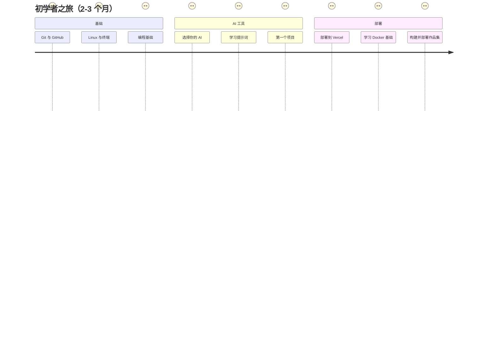
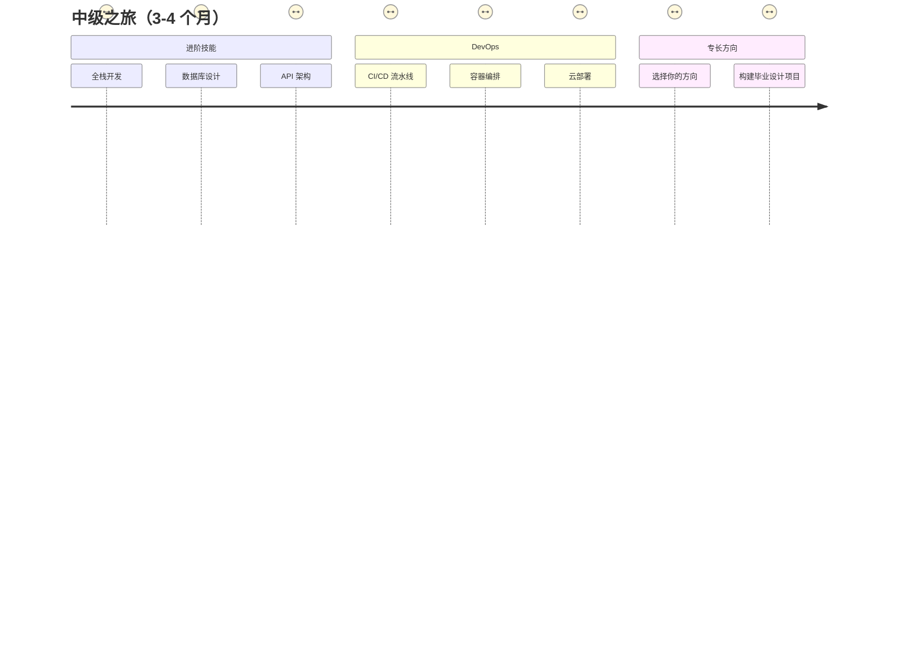
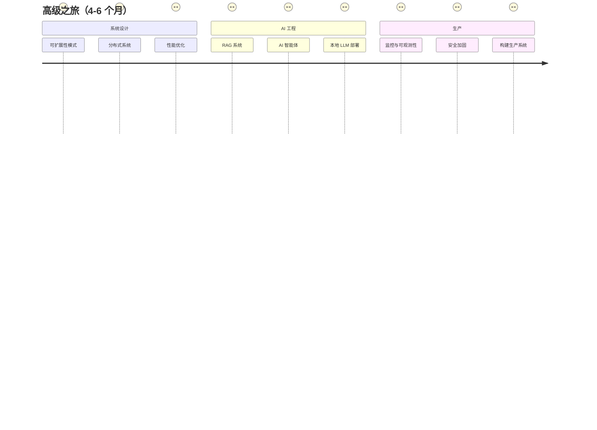

# 🚀 氛围编程（Vibe Coding）：从零到精通

> **AI 辅助软件开发完整开源手册**

[](https://opensource.org/licenses/MIT)
[](zh-CN/CONTRIBUTING.md)
[]()

一本全面、社区驱动的知识库，教你如何借助 AI 辅助，从第一个 "Hello World" 开始，构建可用于生产环境的软件，直至可扩展、可部署的系统。

---

## 📖 目录

- [什么是氛围编程？](#-what-is-vibe-coding)
- [适合哪些人？](#-who-is-this-for)
- [学习路线图](#-learning-roadmap)
- [仓库结构](#-repository-structure)
- [推荐技术栈](#-recommended-tech-stack)
- [AI 工具生态](#-ai-tooling-ecosystem)
- [快速上手](#-getting-started)
- [社区与贡献](#-community--contributions)
- [资源](#-resources)

---

## 🎯 什么是氛围编程？

**Vibe Coding** 是一种现代软件开发方法，工程师与 AI 系统协作，以更快的速度设计、构建、调试、优化、测试、部署和扩展应用，同时保持代码质量与架构完整性。

### 氛围编程工作流


### 氛围编程不是什么 ❌

- ❌ 盲目复制粘贴 AI 代码
- ❌ 替代工程基础
- ❌ 跳过架构与设计
- ❌ 逃避调试与测试
- ❌ 忽视安全最佳实践

### 你需要掌握什么 ✅

| 技能领域 | 重要性 |
|------------|----------------|
| **软件工程** | 基础永远不过时 |
| **提示工程** | 向 AI 清晰传达意图 |
| **系统架构** | 设计可扩展、可维护的系统 |
| **调试** | AI 会犯错，由你来修复 |
| **基础设施** | 在生产环境中部署、监控和扩展 |
| **产品思维** | 构建用户真正需要的东西 |
| **AI 的局限** | 知道何时信任 AI（以及何时不信任） |

> 💡 **目标：** 在保持质量的同时更快地构建软件。

---

## 📊 氛围编程现状（2026）

氛围编程已从新奇事物走向主流实践。截至 2026 年 11 月的关键数据：

| 数据 | 来源 |
|------|--------|
| 约 42% 已提交代码由 AI 生成或辅助生成 | Sonar 2026 调查（1,149 名专业开发者） |
| 72% 的开发者每天使用 AI 工具 | Sonar 2026 |
| 72% 表示纯氛围编程**不是**他们工作流程的一部分 | Stack Overflow 2025 |
| 约 63% 的氛围编程平台用户**不是开发者** | 行业调查（2026） |
| 2025 年 5 月至 9 月，编码智能体生成的 100 万+ 个拉取请求被合并 | GitHub Octoverse 2025 |
| Lovable 达到 1 亿美元 ARR，项目数超 1000 万 | 2025 年 7 月 |
| 96% 的开发者并不完全信任 AI 生成的代码 | Sonar 2026 |
| 65% 接受扫描的氛围编程生产应用存在安全问题（58% 为严重问题） | Escape.tech（1,400+ 个应用） |

**真正的分水岭：** 在于*未经验证的产出*与*可问责的交付*之间。个人开发者常常只看应用的可见功能来评判；专业团队会审查每一次变更、要求测试，并限制智能体的访问权限。

---

## 👥 适合哪些人？

| 受众 | 你将获得什么 |
|----------|------------------|
| **初学者** | 在 AI 指导下开始编码，更快掌握基础 |
| **初级开发者** | 加速学习，构建作品集项目 |
| **高级工程师** | 成倍提升生产力，探索 AI 原生工作流 |
| **自由职业者** | 更快交付项目，承接更多客户 |
| **创业者** | 快速构建 MVP，迅速验证想法 |
| **学生** | 尽早学习现代开发实践 |

---

## 🗺️ 学习路线图

### 初学者路径 🟢



**要构建的项目：**
- ✅ 带身份验证的待办应用
- ✅ 个人作品集网站
- ✅ 天气仪表盘 API
- ✅ 简单博客 CMS

### 中级路径 🟡



**要构建的项目：**
- ✅ SaaS 入门模板
- ✅ AI 驱动的聊天机器人
- ✅ 实时仪表盘
- ✅ 电商平台

### 高级路径 🔴



**要构建的项目：**
- ✅ 基于 Kubernetes 的平台
- ✅ 多智能体 AI 系统
- ✅ 向量搜索引擎
- ✅ 生产级 SaaS 产品

---

## 📁 仓库结构

本仓库包含 **46 个综合章节**，涵盖 AI 辅助开发的方方面面：

### 🏁 基础（第 00-06 节）

| 章节 | 主题 | 状态 |
|---------|-------|--------|
| [00-introduction](zh-CN/00-introduction/) | 欢迎与总览 | 🟡 进行中 |
| [01-what-is-vibe-coding](zh-CN/01-what-is-vibe-coding/) | 理念与心态 | 🟡 进行中 |
| [02-how-to-start](zh-CN/02-how-to-start/) | 入门指南 | 🟡 进行中 |
| [03-hardware-guide](zh-CN/03-hardware-guide/) | 配置要求 | 🟡 进行中 |
| [04-ai-models](zh-CN/04-ai-models/) | 模型对比 | 🟡 进行中 |
| [05-ai-tools](zh-CN/05-ai-tools/) | 工具生态 | 🟡 进行中 |
| [06-ides-editors](zh-CN/06-ides-editors/) | AI 原生 IDE | 🟡 进行中 |

### 💻 核心开发（第 07-14 节）

| 章节 | 主题 | 状态 |
|---------|-------|--------|
| [07-prompt-engineering](zh-CN/07-prompt-engineering/) | 提示词模板与技巧 | 🟡 进行中 |
| [08-frontend](zh-CN/08-frontend/) | React、Next.js、TypeScript | 🟡 进行中 |
| [09-backend](zh-CN/09-backend/) | API、微服务 | 🟡 进行中 |
| [10-databases](zh-CN/10-databases/) | SQL、NoSQL、向量数据库 | 🟡 进行中 |
| [11-devops-cloud](zh-CN/11-devops-cloud/) | Docker、K8s、云 | 🟡 进行中 |
| [12-hosting-platforms](zh-CN/12-hosting-platforms/) | 部署选项 | 🟡 进行中 |
| [13-testing-debugging](zh-CN/13-testing-debugging/) | 质量保证 | 🟡 进行中 |
| [14-security](zh-CN/14-security/) | 安全最佳实践 | 🟡 进行中 |

### 🚀 进阶主题（第 15-24 节）

| 章节 | 主题 | 状态 |
|---------|-------|--------|
| [15-offline-vibe-coding](zh-CN/15-offline-vibe-coding/) | 本地 AI 与隐私 | 🟡 进行中 |
| [16-open-source-projects](zh-CN/16-open-source-projects/) | 项目创意 | 🟡 进行中 |
| [17-real-world-workflows](zh-CN/17-real-world-workflows/) | 生产工作流 | 🟡 进行中 |
| [18-monetization](zh-CN/18-monetization/) | 变现 | 🟡 进行中 |
| [19-freelancing](zh-CN/19-freelancing/) | 客户工作 | 🟡 进行中 |
| [20-system-design](zh-CN/20-system-design/) | 架构模式 | 🟡 进行中 |
| [21-mobile-development](zh-CN/21-mobile-development/) | React Native、Flutter | 🟡 进行中 |
| [22-ai-agents](zh-CN/22-ai-agents/) | 自主智能体 | 🟡 进行中 |
| [23-rag-vector-databases](zh-CN/23-rag-vector-databases/) | RAG 系统 | 🟡 进行中 |
| [24-automation](zh-CN/24-automation/) | CI/CD、脚本 | 🟡 进行中 |

### 📚 资源（第 25-45 节）

| 章节 | 主题 | 难度 | 状态 |
|---------|-------|------------|--------|
| [25-cheat-sheets](zh-CN/25-cheat-sheets/) | 速查表 | — | 🟡 进行中 |
| [26-awesome-prompts](zh-CN/26-awesome-prompts/) | 提示词库 | — | 🟡 进行中 |
| [27-case-studies](zh-CN/27-case-studies/) | 真实案例分析 | — | 🟡 进行中 |
| [28-failure-patterns](zh-CN/28-failure-patterns/) | 应该避免的做法 | — | 🟡 进行中 |
| [29-interview-prep](zh-CN/29-interview-prep/) | 面试问题 | — | 🟡 进行中 |
| [30-spec-driven-development](zh-CN/30-spec-driven-development/) | 规格重于提示词 | 🟡 中级 | 🟡 进行中 |
| [31-ai-cost-engineering](zh-CN/31-ai-cost-engineering/) | Token 成本与预算 | 🟡 中级 | 🟡 进行中 |
| [32-agent-safety-governance](zh-CN/32-agent-safety-governance/) | 智能体安全与治理 | 🟡 中级 | 🟡 进行中 |
| [33-enterprise-governance](zh-CN/33-enterprise-governance/) | 企业治理与可靠性 | 🟡 中级 | 🟡 进行中 |
| [34-community-case-studies](zh-CN/34-community-case-studies/) | 案例研究与失败分析 | 🟡 中级 | 🟡 进行中 |
| [35-starter-kits](zh-CN/35-starter-kits/) | 入门套件与模板 | 🟡 中级 | 🟡 进行中 |
| [36-kubernetes-deployment](zh-CN/36-kubernetes-deployment/) | Kubernetes 部署 | 🔴 高级 | 🟡 进行中 |
| [37-self-assessment](zh-CN/37-self-assessment/) | 自我评估与认证 | 🟡 中级 | 🟡 进行中 |
| [38-interactive-quizzes](zh-CN/38-interactive-quizzes/) | 测验与认证路径 | 🟡 中级 | 🟡 进行中 |
| [39-video-tutorials](zh-CN/39-video-tutorials/) | 视频教程与演示 | 🟢 初级 | 🟡 进行中 |
| [40-community-discussion](zh-CN/40-community-discussion/) | 社区与贡献工具 | 🟢 初级 | 🟡 进行中 |
| [41-ecosystem-integrations](zh-CN/41-ecosystem-integrations/) | MCP 市场与智能体模板 | 🟡 中级 | 🟡 进行中 |
| [42-aiops-ai-workloads](zh-CN/42-aiops-ai-workloads/) | 面向 AI 工作负载的 AIOps | 🔴 高级 | 🟡 进行中 |
| [43-agent-collaboration](zh-CN/43-agent-collaboration/) | 智能体间协作 | 🔴 高级 | 🟡 进行中 |
| [44-compliance-automation](zh-CN/44-compliance-automation/) | 高级合规自动化 | 🔴 高级 | 🟡 进行中 |
| [45-multi-modal-vibe-coding](zh-CN/45-multi-modal-vibe-coding/) | 多模态氛围编程 | 🟡 中级 | 🟡 进行中 |

**图例：** ✅ 已完成 | 🟡 进行中 | 🔴 计划中 | 🟢 初级 | 🟡 中级 | 🔴 高级

---

## 🛠️ 推荐技术栈

基于行业趋势与 AI 兼容性：

### 前端开发

```
┌─────────────────────────────────────┐
│           FRONTEND STACK            │
├─────────────────────────────────────┤
│ Framework   │ React / Next.js       │
│ Language    │ TypeScript            │
│ Styling     │ TailwindCSS + Shadcn  │
│ State       │ Zustand / Redux       │
│ Testing     │ Vitest + Playwright   │
└─────────────────────────────────────┘
```

### 后端开发

```
┌─────────────────────────────────────┐
│           BACKEND STACK             │
├─────────────────────────────────────┤
│ Runtime     │ Node.js / Bun         │
│ Framework   │ Express / Fastify     │
│ Alternative │ Python (FastAPI)      │
│ Alternative │ Go                    │
│ API Style   │ REST / GraphQL        │
│ Auth        │ JWT / OAuth2          │
└─────────────────────────────────────┘
```

### DevOps 与基础设施

```
┌─────────────────────────────────────┐
│          DEVOPS STACK               │
├─────────────────────────────────────┤
│ Containers  │ Docker                │
│ Orchestration│ Kubernetes           │
│ IaC         │ Terraform             │
│ CI/CD       │ GitHub Actions        │
│ Monitoring  │ Prometheus + Grafana  │
│ Logging     │ ELK Stack             │
└─────────────────────────────────────┘
```

### AI 与机器学习

```
┌─────────────────────────────────────┐
│            AI STACK                 │
├─────────────────────────────────────┤
│ Local       │ Ollama + LM Studio    │
│ Cloud       │ Claude / GPT-4        │
│ Open Source │ DeepSeek / Qwen       │
│ UI          │ Open WebUI            │
│ IDE Plugin  │ Continue / Cursor     │
│ Embeddings  │ Sentence Transformers │
└─────────────────────────────────────┘
```

### 数据库

| 类型 | 技术 | 用例 |
|------|------------|----------|
| **关系型** | PostgreSQL | 主要数据存储 |
| **缓存** | Redis | 会话管理、缓存 |
| **向量** | Pinecone / Qdrant | AI 嵌入、RAG |
| **文档型** | MongoDB | 灵活的模式 |
| **搜索** | Elasticsearch | 全文搜索 |

---

## 🤖 AI 工具生态

### AI 驱动的 IDE 与编码智能体

2026 年的胜出模式是：将**编辑器内助手**（Cursor / Copilot，用于自动补全和快速编辑）与**终端智能体**（Claude Code / Codex，用于繁重的自主工作）搭配使用。

| 工具 | 类型 | 适用场景 | 定价 |
|------|------|----------|---------|
| **[Cursor](https://cursor.com)** | AI 优先 IDE | 日常功能开发、Composer 2.5、并行智能体 | 免费版 / 20–200 美元/月 |
| **[Claude Code](https://claude.com/code)** | 终端智能体 | 深度仓库工作、长时间运行的智能体任务 | 20–200 美元/月 |
| **[OpenAI Codex](https://openai.com/codex)** | CLI + 云端智能体 | OpenAI 技术栈团队、委派任务 | ChatGPT 套餐 / API |
| **[Google Antigravity 2.0](https://antigravity.google)** | 智能体优先平台 | 多智能体编排、浏览器测试 | 免费 / 约 20 美元 / 100 美元 |
| **[GitHub Copilot](https://github.com/features/copilot)** | IDE 智能体 | GitHub 原生团队、最低入门价格 | 免费 / 10–39 美元/月 |
| **[Kiro](https://kiro.dev)** | 规格驱动 IDE | 先写规格、再出设计、再拆任务，然后写代码 | 20–40 美元/月 |
| **[Devin Desktop](https://devin.ai)** | IDE + 云端智能体 | 本地 + 云端智能体委派（前身为 Windsurf） | 免费版 / 付费 |
| **[Cline](https://cline.bot)** | VS Code 扩展 + CLI | 开源、自带 API 密钥 | 免费 + API 用量 |
| **[OpenHands](https://openhands.dev)** | 开源智能体 | 无头/CI 自动化、自托管 | 免费（MIT） |

### AI 聊天助手（旗舰 / 中端 / 高性价比）

| 模型 | 系列 | 适用场景 | 上下文 | 价格（每 100 万 token 输入/输出） |
|-------|--------|----------|---------|-----------------------------|
| **Claude Opus 5.5** | Anthropic | 长时间运行的智能体编程、复杂多文件工作 | 1M | 4 美元 / 20 美元 |
| **Claude Sonnet 5.5** | Anthropic | 日常编程、性价比最高的中端模型 | 1M | 2 美元 / 10 美元 |
| **Claude Fable 5.1** | Anthropic | 最难的推理、长周期智能体工作 | 1M | 10 美元 / 50 美元 |
| **GPT-6 Astra** | OpenAI | 复杂推理与编程旗舰 | ~1M | 10 美元 / 50 美元 |
| **GPT-6.1 Sol** | OpenAI | 以更低成本接近 Astra 的性能 | ~1M | 约 2–4 美元 / 10–20 美元 |
| **GPT-6.1 Terra** | OpenAI | 性价比最高的档位 | ~1M | 2 美元 / 10 美元 |
| **Gemini 4 Argon** | Google | 真实世界软件工程旗舰 | ~1M | 约 2 美元 / 10 美元 |
| **DeepSeek V4 Flash** | DeepSeek | 开放权重、快速且便宜 | 1M | 0.15 美元 / 0.60 美元 |
| **Kimi K3** | Moonshot AI | 顶级开放权重模型 | 1M+ | 3 美元 / 15 美元 |

> 💡 **模型路由规则（2026）：** 按任务路由，而非凭习惯。复杂多文件/智能体工作 → 旗舰（Opus 5.5、Astra、Argon）。日常编程 → 中端（Sonnet 5.5、Sol、Flash）。高频/重复步骤 → 便宜/快速档位（Haiku 5.5、Luna、Terra、Flash-Lite）。

### 本地 AI 配置

```bash
# Install Ollama
curl -fsSL https://ollama.com/install.sh | sh

# Pull current open-weight coding models
ollama pull deepseek-v4-flash
ollama pull glm-5.3
ollama pull kimi-k3

# Run with Open WebUI
docker run -d -p 3000:8080 \
  --add-host=host.docker.internal:host-gateway \
  -v open-webui:/app/backend/data \
  ghcr.io/open-webui/open-webui:main
```

---

## 🎓 快速上手

### 第 1 步：配置环境

```bash
# Clone this repository
git clone https://github.com/yourusername/vibe-coding-zero-to-hero.git
cd vibe-coding-zero-to-hero

# Install essential tools
# - Git, Node.js, Docker
# - VS Code or Cursor
# - Ollama for local AI
```

### 第 2 步：选择学习路径

1. **完全的新手？** → 从 [02-how-to-start](zh-CN/02-how-to-start/) 开始
2. **已有基础？** → 跳到 [07-prompt-engineering](zh-CN/07-prompt-engineering/)
3. **准备动手构建？** → 查看 [16-open-source-projects](zh-CN/16-open-source-projects/)
4. **想要本地 AI？** → 参见 [15-offline-vibe-coding](zh-CN/15-offline-vibe-coding/)

### 第 3 步：构建你的第一个项目

采用基于项目的学习方法：

1. 从路线图中挑选一个项目
2. 用 AI 生成初始代码
3. 理解每一行代码（不要盲目复制粘贴！）
4. 在 AI 协助下调试问题
5. 部署并分享你的作品

---

## 🤝 社区与贡献

这是一个**社区驱动**的项目。我们欢迎各种形式的贡献！

### 如何贡献

- 📝 **撰写指南** - 在任何章节分享你的专业知识
- 🎨 **制作图表** - 可视化讲解帮助所有人
- 🐛 **报告问题** - 发现错误或缺口？请告诉我们
- 💡 **建议主题** - 接下来应该涵盖什么？
- 🔧 **改进工具** - 更好的工作流、脚本、模板

### 贡献指南

1. 阅读我们的[贡献指南](zh-CN/CONTRIBUTING.md)
2. 开始前查看现有的 [Issues](../../issues)
3. 遵循我们的 [Markdown 风格指南](zh-CN/CONTRIBUTING.md#markdown-standards)
4. 提交拉取请求并附上清晰的描述

### 加入社区

- 💬 讨论区：[GitHub Discussions](../../discussions)
- 🐦 Twitter：[@YourHandle](#) *（即将推出）*
- 💻 Discord：*（即将推出）*

---

## 📚 资源

### 必读

- [Blueprint.md](zh-CN/Blueprint.md) - 完整的愿景与结构
- [ROADMAP.md](zh-CN/ROADMAP.md) - 详细学习时间线
- [RESOURCES.md](zh-CN/RESOURCES.md) - 精选外部链接
- [CONTRIBUTING.md](zh-CN/CONTRIBUTING.md) - 如何贡献

### 外部资源

| 类别 | 资源 |
|----------|----------|
| **学习 Git** | [Git Handbook](https://guides.github.com/introduction/git-handbook/) |
| **学习 React** | [React Docs](https://react.dev) |
| **学习 Docker** | [Docker Docs](https://docs.docker.com) |
| **提示工程** | [Prompt Engineering Guide](https://www.promptingguide.ai) |
| **系统设计** | [System Design Primer](https://github.com/donnemartin/system-design-primer) |

---

## 📄 许可证

本项目采用 [MIT 许可证](LICENSE)。

---

## 🙏 致谢

由社区用 ❤️ 构建，为社区而建。

特别感谢所有让 AI 辅助开发人人可及的贡献者。

---

<div align="center">

**🚀 准备好开始氛围编程了吗？**

[开始](zh-CN/02-how-to-start/) · [查看路线图](zh-CN/ROADMAP.md) · [参与贡献](zh-CN/CONTRIBUTING.md)

</div>
