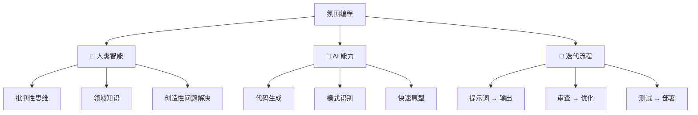
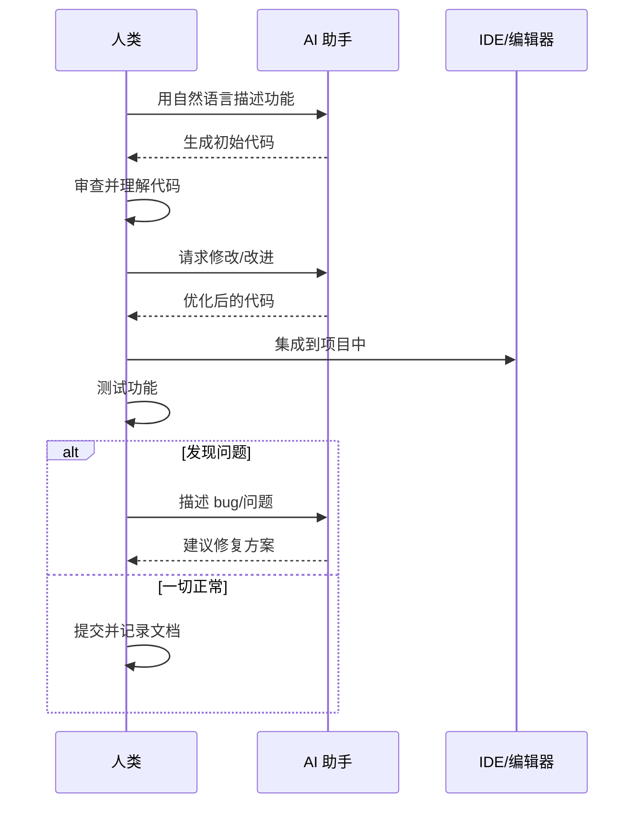

[English 原文](../../01-what-is-vibe-coding/README.md)

# 🧠 01 - 什么是氛围编程？

*最后更新：2026 年 11 月*

> **“氛围编程”是凭直觉、创造力和战略思维指挥 AI 构建软件的艺术。**  
> 它不是要取代开发者——而是要以 AI 作为你全天候的结对编程伙伴，放大人的潜力。

---

## 📖 目录

- [定义](#definition)
- [编程的演进](#the-evolution-of-programming)
- [氛围编程现状（2026）](#state-of-vibe-coding-2026)
- [核心原则](#core-principles)
- [氛围编程 vs 传统编程](#vibe-coding-vs-traditional-coding)
- [氛围编程工作流](#the-vibe-coding-workflow)
- [关键概念](#key-concepts)
- [常见误解](#common-misconceptions)
- [大辩论：该退休这个词了吗？](#the-great-debate-should-we-retire-the-term)
- [真实案例](#real-world-examples)
- [自我评估](#self-assessment)
- [下一步](#next-steps)

---

## 🎯 定义

**Vibe Coding**（也称 AI 辅助开发或 AI 结对编程）是一种现代软件开发方法：

> 开发者通过自然语言对话，利用 AI 模型生成、审查、调试和优化代码，专注于高层架构、逻辑和用户体验，而 AI 负责处理重复性的实现细节。

### 氛围编程的三大支柱



---

## 📜 编程的演进

| 时代 | 时期 | 工具 | 开发者的角色 |
|-----|-------------|-------|----------------|
| **1.0 手工** | 1950 年代-1980 年代 | 打孔卡、汇编 | 每一位都重要 |
| **2.0 高级语言** | 1980 年代-2000 年代 | C、Java、IDE | 逻辑与结构 |
| **3.0 框架** | 2000 年代-2010 年代 | Rails、Django、React | 配置与胶水代码 |
| **4.0 AI 辅助** | 2020 年代-2025 年 | Copilot、Claude、Cursor | 指挥与审查 |
| **4.5 智能体** | 2025-2026 年 | Claude Code、Cursor agents、GitHub coding agent | 审查并合并智能体的 PR |
| **5.0 自主** | 2026 年- | AI 智能体作为队友 | 战略与监督 |

> **⚡ 2026 年更新：** “5.0 自主”已不再是未来——它已成为主流。GitHub 的编码智能体在 2025 年 5 月至 9 月间合并了 **100 万+ 个拉取请求**（Octoverse 2025）；Anthropic 的工程师报告 Claude 写了他们团队*“ literally 全部”*的代码；2026 年，Oracle 估计**如今大部分代码已由机器生成**。开发者的角色已从写代码转变为指挥智能体，并对它们交付的内容负责。

### 为什么是现在？

氛围编程的转变之所以发生，是因为：

1. **AI 模型成熟了**：LLM 如今能理解上下文和模式，并能生成可用于生产的代码
2. **工具改进了**：IDE 和智能体原生集成了 AI（Cursor、GitHub Copilot、Claude Code、Devin Desktop——前身为 Windsurf；Codeium 这个旧的补全品牌已经停用）
3. **速度要求**：市场期望更快的 MVP 和迭代
4. **知识民主化**：初学者也能构建过去需要多年经验才能完成的东西
5. **智能体取代了自动补全**：编码智能体不再只是建议下一行代码——它们检查整个仓库、修改多个文件、运行命令和测试，并准备好变更供人类审查

---

## 📊 氛围编程现状（2026）

用数字看这项实践的实际状况：

| 指标 | 发现 | 来源 |
|--------|---------|--------|
| 使用或计划使用 AI 工具的开发者 | **84%** | Stack Overflow 2025 开发者调查 |
| 表示氛围编程*不是*其工作流程一部分的开发者（另有 5% 表示“坚决不是”） | **72%** | Stack Overflow 2025 开发者调查 |
| 每天使用 AI 工具的专业开发者 | **72%** | Sonar 2026（1,149 名专业开发者） |
| 已提交代码中由 AI 生成或辅助生成的比例 | **约 42%** | Sonar 2026 |
| 包含 AI 的原型 | **88%** | Sonar 2026 |
| 包含 AI 的面向客户应用 | **73%** | Sonar 2026 |
| 包含 AI 的业务关键服务 | **58%** | Sonar 2026 |
| 不完全信任 AI 代码功能正确的开发者 | **96%** | Sonar 2026 |
| 认为 AI 代码比同事的代码更难审查的开发者 | **38%** | Sonar 2026 |
| 氛围编程平台用户中*不是*开发者的比例 | **约 63%** | 2026 年平台数据 |
| GitHub 编码智能体生成并合并的拉取请求，2025 年 5 月至 9 月 | **100 万+** | GitHub Octoverse 2025 |
| GitHub 上合并的拉取请求总数（**同比 +29%**） | **5.187 亿** | GitHub Octoverse 2025 |
| Lovable ARR（2025 年 7 月）/ 创建的项目数 | **1 亿美元 / 1000 万+** | Lovable |

**解读这些数字：**

- **增长来自新入场者，而不是开发者取代自己。** 约 63% 的氛围编程平台用户不是开发者——这波浪潮是那些从未写过代码的人第一次发布软件。
- **采用速度超过信任。** AI 触及了 88% 的原型和 73% 的面向客户应用，但 96% 的开发者并不完全信任 AI 生成的代码是正确的，38% 的人认为它比同事的代码更难审查。
- **智能体大规模交付。** GitHub 的编码智能体在短短五个月窗口（2025 年 5 月至 9 月）内合并了 100 万+ 个 PR，在总计 5.187 亿个合并 PR（同比 +29%）中占有一席之地；Lovable 到 2025 年 7 月达到了 1 亿美元 ARR，项目数超 1000 万。

### 真正的分水岭

这项实践已分裂为两个截然不同的阵营：

| 个人开发者 | 专业团队 |
|---------------|--------------------|
| 以可见功能评判应用 | 审查每一次变更 |
| 快速发布，事后修复 | 合并前要求测试 |
| 给智能体宽泛的访问权限 | 用限定权限限制智能体访问 |

**真正的分水岭在于未经验证的产出与可问责的交付之间**——而不是“AI 使用者”与“非 AI 使用者”之间。

---

## 💎 核心原则

### 1. **意图重于实现**
关注你想构建*什么*，而不是每一行代码*怎么写*。

```markdown
❌ 传统方式：“我需要写一个 for 循环来遍历这个数组……”
✅ 氛围编程：“筛选这个列表，只显示 30 岁以下的活跃用户”
```

### 2. **迭代优化**
很少有提示词第一次就给出完美代码。拥抱这个循环：

```
提示词 → 审查 → 发现问题 → 优化提示词 → 更好的输出 → 测试 → 部署
```

### 3. **验证是关键**
信任但要验证。AI 会犯错。务必：
- ✅ 阅读生成的代码
- ✅ 理解逻辑
- ✅ 测试边界情况
- ✅ 验证安全影响

### 4. **上下文为王**
更好的上下文 = 更好的输出。提供：
- 业务需求
- 技术约束
- 现有代码库模式
- 性能预期

### 5. **人在回路中**
AI 提建议，人做决定。你仍需对以下事项负责：
- 架构决策
- 安全与隐私
- 用户体验
- 伦理考量

---

## ⚡ 氛围编程 vs 传统编程

| 方面 | 传统编程 | 氛围编程 |
|--------|-------------------|-------------|
| **速度** | 功能开发需要数小时到数天 | 数分钟到数小时 |
| **学习曲线** | 掌握语法需要数年 | 学习提示词只需数天 |
| **重点** | 语法、模式、调试 | 逻辑、架构、用户体验 |
| **工具** | IDE、调试器、文档 | AI 助手 + IDE |
| **错误** | 手动调试 | AI 帮助识别与修复 |
| **样板代码** | 全部自己写 | AI 即时生成 |
| **知识** | 背诵 API | 向 AI 索取示例 |
| **重构** | 耗时 | AI 辅助快速重写 |

### 生产力对比

```
传统开发者（8 小时）：
├── 2 小时：调研与规划
├── 4 小时：写代码
├── 1.5 小时：调试
└── 0.5 小时：测试

氛围编程者（8 小时）：
├── 1 小时：规划与提示词
├── 1 小时：审查 AI 输出
├── 2 小时：集成与定制
├── 1 小时：测试
└── 3 小时：构建更多功能
```

---

## 🔄 氛围编程工作流

### 标准工作流



### 每日工作流示例

**上午：**
1. ☕ 回顾昨天的代码和测试
2. 📝 与 AI 头脑风暴，规划今天的功能
3. 🚀 生成样板代码和脚手架

**深度工作时段：**
4. 🏗️ 通过迭代提示词构建核心逻辑
5. 🔍 结合 AI 建议审查、重构和优化
6. 🧪 编写测试（AI 生成、人工验证）

**下午：**
7. 🔧 与 AI 结对调试问题
8. 📚 为代码编写文档并更新 README
9. 🎯 规划明天的任务

---

## 🔑 关键概念

### 1. **提示工程**
为 AI 编写有效指令的技能。

**示例进阶：**
```markdown
第 1 级（基础）：“创建一个登录表单”

第 2 级（更好）：“创建一个带邮箱和密码的 React 登录表单”

第 3 级（进阶）：
“创建一个 React 登录表单组件，要求：
- 邮箱验证（RFC 5322）
- 密码强度指示器（最少 8 个字符、1 个数字、1 个特殊字符）
- 记住我复选框
- 忘记密码链接
- 网络失败的错误处理
- 无障碍（ARIA 标签、键盘导航）
- 用 Tailwind CSS 样式
- 包含 TypeScript 类型”
```

### 2. **上下文窗口管理**
理解 AI 的记忆上限并提供相关上下文。

**最佳实践：**
- 保持提示词聚焦（理想为 500-2000 个 token）
- 需要时引用具体文件
- 总结之前的对话以保持连续性
- 使用系统提示词保持行为一致

### 3. **代码审查思维**
从写作者转变为审查者/编辑者。

**要问的问题：**
- ❓ 这是否正确解决了问题？
- ❓ 是否存在安全漏洞？
- ❓ 代码是否高效且可读？
- ❓ 是否遵循我们的项目规范？
- ❓ 边界情况是否已处理？

### 4. **渐进式披露**
逐步构建，循序渐进地揭示复杂性。

```
第 1 步：基本功能能跑通
第 2 步：添加错误处理
第 3 步：优化性能
第 4 步：添加日志/监控
第 5 步：编写全面的测试
```

---

## 🚫 常见误解

| 误解 | 现实 |
|------|---------|
| “AI 会取代开发者” | AI 取代的是任务，而不是工作。使用 AI 的开发者会取代不使用 AI 的开发者。 |
| “你不需要懂编码” | 理解基础知识能帮助你更有效地验证和引导 AI。 |
| “AI 代码总是有 bug” | 有了好的提示词和审查，AI 能产出生产质量的代码。 |
| “这是作弊” | 这是在利用工具，就像用计算器做数学题。 |
| “只适合简单项目” | 复杂系统由组合 AI 生成的组件构建而成。 |
| “你会失去控制” | 通过更快地行动，你能掌控技术栈的更多部分。 |
| “能跑起来就是能用” | 能跑不等于可靠：96% 的开发者并不完全信任 AI 代码功能正确（Sonar 2026），而且只有 48% 的人总是在提交前检查它。 |

> **⚠️ 氛围编程不是什么：** 它不等于创建一个*可靠*的应用。OWASP 与 RTÉ 的报道（2026 年 11 月）记录了“应用存在”与“应用能用”之间的差距：算错账的预算应用、接受冲突预订的预订系统、泄露个人数据的网站。创建一个应用不等于创建一个可靠的应用——交付值得信赖的软件仍然需要审查、测试和护栏（见 [14 - 安全](../14-security/)）。

---

## 🗳️ 大辩论：该退休这个词了吗？

很少有双词短语能传播得像“氛围编程”这么远——到 2026 年底，这种成功引发了一场关于是否应该退休这个词的辩论。

**辩论时间线：**

- **2025 年 2 月** — Andrej Karpathy 创造了 *“vibe coding”*：凭感觉接受 AI 的改动，完全信任模型，而不读代码。
- **2025 年底** — 柯林斯词典将 *vibe coding* 评为 **2025 年度词汇**，使其进入日常语言。
- **2026 年 11 月 3 日** — Point Nine 投资人 **Christoph Janz** 提议退休这个词，认为如今说 *“我构建了 XYZ”* 已经隐含了 AI 写了大部分代码——这个限定词不再起作用。
- **反对声音** — 批评者说，这个标签仍然传递着真实的信号：未经理解或审查就发布的软件。此时退休这个词，他们认为，恰恰会在生成代码无处不在之时抹掉一个警告标志。

**正在形成的解决方案：拆分这个词。**

| 用这个词 | 当你指的是 |
|---------------|---------------|
| **AI 辅助工程** | 经过审查、有人负责的代码——人类理解、测试并对发布的内容负责 |
| **氛围编程** | 快速构建、不经深入审查的一次性原型和实验——以及 Karpathy 的原意：凭感觉接受改动而不读代码 |

双方各取所需：批评者保留了一个能标记未审查软件的词，Janz 则让这个词不再被用于严肃、可问责的工程。实际启示是：当 2026 年有人说“氛围编程”时，问问他们指的是哪一种——**真正的差别在于是否有人对代码的行为负责。**

---

## 🌟 真实案例

### 案例 1：创业 MVP

**场景：** 独立创始人构建 SaaS 产品

**传统方式：**
- 3 个月构建 MVP
- 雇佣 2-3 名开发者（3 万美元+）
- 延迟进入市场

**氛围编程方式：**
- 2 周构建 MVP
- 独立开发者 + AI
- 上线、获取反馈、快速迭代

**生成的技术栈：**
```
Frontend: Next.js + Tailwind CSS + shadcn/ui
Backend: Supabase (Auth + Database)
Payments: Stripe integration
Deployment: Vercel
```

### 案例 2：企业迁移

**场景：** 将遗留 PHP 应用迁移到现代技术栈

**传统方式：**
- 6 个月时间线
- 大型团队协调
- 回归风险高

**氛围编程方式：**
- AI 分析现有代码
- 生成迁移计划
- 逐模块转换代码
- 自动生成测试
- 2 个月时间线，更小的团队

### 案例 3：学习之旅

**学生画像：** 没有编码经验

**第 1 个月：** 在 AI 导师帮助下学习基础
**第 2 个月：** 构建简单 Web 应用
**第 3 个月：** 创建作品集项目
**第 4 个月：** 接到第一份自由职业工作

---

## 📊 自我评估

### 你在氛围编程谱系上的位置？

**给自己打分（每项 1-5 分）：**

| 技能 | 评分 | 描述 |
|-------|--------|-------------|
| **提示词清晰度** | _/5 | 你能清楚描述自己想要什么吗？ |
| **代码阅读** | _/5 | 你能理解 AI 生成的代码吗？ |
| **调试** | _/5 | 你能识别并修复问题吗？ |
| **架构** | _/5 | 你能设计系统结构吗？ |
| **验证** | _/5 | 你会彻底测试 AI 的输出吗？ |

**评分：**
- **5-10**：初级 - 重点学习第 02-07 节
- **11-17**：中级 - 跳到特定领域的章节（08-15）
- **18-25**：高级 - 探索变现与进阶主题（16-29）

---

## 🛠️ 实践练习

### 练习 1：第一次体验
**目标：** 体验整个流程

1. 打开你的 AI 助手
2. 输入提示词：“创建一个带计数按钮的简单 HTML 页面”
3. 把代码复制到文件
4. 在浏览器中打开
5. 庆祝！🎉

### 练习 2：迭代改进
**目标：** 练习优化

1. 从练习 1 的基础提示词开始
2. 逐个添加需求：
   - “添加样式，让它看起来现代”
   - “添加重置按钮”
   - “把计数保存到 localStorage”
   - “添加动画”
3. 注意每次迭代如何改进结果

### 练习 3：找 Bug
**目标：** 培养验证技能

1. 让 AI 创建一个带隐蔽 bug 的函数
2. 尝试在不运行代码的情况下找到 bug
3. 运行并测试以确认
4. 让 AI 修复它
5. 对比你的发现与 AI 的修复

---

## 📚 推荐资源

### 文章与博客
- [The Rise of AI Pair Programmers](https://example.com)
- [提示工程最佳实践](../07-prompt-engineering/)
- [从零到发布：氛围编程之旅](../27-case-studies/)

### 视频
- [氛围编程简介（YouTube）](https://youtube.com)
- [用 Claude 构建应用（教程）](https://youtube.com)
- [Cursor IDE 演示](https://youtube.com)

### 探索工具
- [Cursor](https://cursor.sh/) - AI 原生 IDE
- [GitHub Copilot](https://github.com/features/copilot) - 代码补全
- [Claude](https://claude.ai/) - 对话式 AI
- [Replit AI](https://replit.com/) - 浏览器端开发

---

## 🎯 下一步

现在你已经理解了氛围编程是什么：

1. ✅ **完成**：阅读 [02 - 如何开始](../02-how-to-start/)，获取可操作的步骤
2. ✅ **配置**：查看 [03 - 硬件指南](../03-hardware-guide/)，了解最佳配置
3. ✅ **掌握**：学习 [07 - 提示工程](../07-prompt-engineering/)，实现最高效率
4. ✅ **练习**：在第 02 节的指导下开始构建

---

## 💬 讨论问题

思考这些问题并在讨论区分享：

1. 你对 AI 辅助编码最大的担忧是什么？
2. 描述一个你希望用 AI 自动化的任务
3. 你有什么编程经验（如果有的话）？
4. 你对哪类项目最感兴趣？

---

> **💡 专业提示**：学习氛围编程最好的方式是从小处着手、频繁发布，并逐步挑战更复杂的项目。不要追求完美——追求进步！

---

<div align="center">

**准备好开始你的旅程了吗？**  
➡️ [下一节：如何开始](../02-how-to-start/) ⬅️

[⬆️ 回到简介](../00-introduction/)

由 Vibe Coding 社区用 ❤️ 制作

</div>
