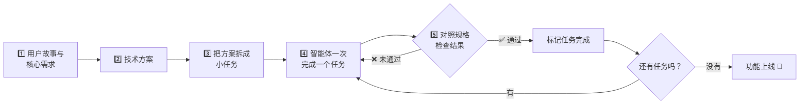
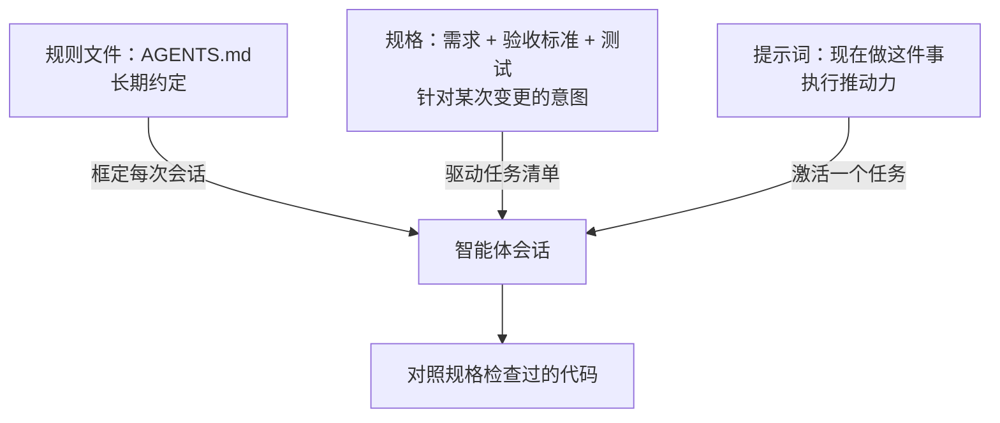

[English 原文](../../30-spec-driven-development/README.md)

# 📋 30 - 规格驱动开发

> **规格，而非一次性提示词，如今已成为指挥 AI 编程智能体的主要方式。**
> 在写代码之前，先记录需求、限制与测试——然后让智能体对照它们来构建。

**难度：** 🟡 中级 · **阅读时间：** 约 12 分钟

---

## 📖 目录

- [为什么规格取代了一次性提示词](#-why-specs-replaced-one-shot-prompts)
- [规格驱动工作流](#-the-spec-driven-workflow)
- [规格工具全景](#-the-spec-tooling-landscape)
- [一份好规格的构成](#-anatomy-of-a-good-spec)
- [实战示例：从模糊提示词到精简规格](#-worked-example-from-vague-prompt-to-compact-spec)
- [规格 vs 提示词 vs 规则文件](#-spec-vs-prompt-vs-rules-file)
- [常见失败模式](#-common-failure-modes)
- [实践清单](#-practical-checklist)
- [自我评估](#-self-assessment)
- [关键要点](#-key-takeaways)
- [下一步](#-next-steps)

---

## 🎯 为什么规格取代了一次性提示词

**提示词（prompt）** 是在一轮对话中告诉智能体要做什么。**规格（specification）** 则记录成品必须满足的需求、限制与测试——并在智能体工作期间一直留在那里。

2026 年，规格超越提示词，成为指挥 AI 编程智能体的默认方式。GitHub 的 Octoverse 与 2026 年的工具趋势都指向同一个方向：智能体如今可以跨多个文件连续工作数小时，一条聊天消息装不下这么多意图。能装下的是一份小而有版本管理的规格，就放在它所描述的代码旁边。

| | 一次性提示词 | 规格 |
|---|---|---|
| **生命周期** | 随聊天轮次结束而消失 | 保存在仓库中，跨会话留存 |
| **承载内容** | 一条指令 | 需求 + 限制 + 测试 |
| **范围** | 本轮对话 | 本功能/本次变更 |
| **可审查性** | ❌ 埋在历史记录里 | ✅ 可 diff、可评论、可签核 |
| **编写时机** | 工作进行中 | 编码开始前 |
| **失败模式** | 下一轮就被遗忘 | 不更新就会漂移 |

### 这一转变为何发生

1. **智能体的缰绳放长了。** 现代智能体能执行多步骤、多文件的任务。运行时间越长，事后才发现缺了某项需求，代价就越大。
2. **上下文重读便宜，重新决策不便宜。** 重读代码成本很低；重新决定"完成"意味着什么，成本很高。
3. **团队需要可审查的产物。** 无法对照书面完成定义来检查的 AI 产出，除了作者本人，谁都批不了。
4. **工具跟上了。** GitHub Spec Kit、Kiro 以及 `AGENTS.md` 这类标准，让写规格变得和写提示词一样容易。

---

## 🔄 规格驱动工作流



### 五个步骤

1. **写用户故事与核心需求**——谁需要什么，为什么需要。
2. **把它们变成技术方案**——技术选型、数据流、接口。
3. **把方案拆成小任务**——每个任务都小到走错一步也能低成本回退。
4. **让智能体一次完成一个任务**——每次运行只做一个聚焦的工作单元，而不是马拉松。
5. **对照规格检查每个结果**——规格是裁判，而不是你对聊天的记忆。

> **💡 规格不需要很长。** 一份能在编码开始前讲清预期结果的精简规格，胜过一份没人读的 20 页文档。目标是五分钟能审完的东西。

---

## 🛠️ 规格工具全景

### 规格框架与 IDE

| 工具 | 是什么 | 如何工作 |
|------|-----------|--------------|
| **[GitHub Spec Kit](https://github.com/github/spec-kit)** | 开源规格驱动工具包 | CLI，在你的仓库中组织 `spec → plan → tasks → implement` |
| **Kiro (AWS)** | 规格驱动 IDE | 规格 → 设计 → 任务，外加 steering 文件、钩子，以及支持并行工作流的并行 Specs |
| **智能体中的规格驱动工作流** | 任何有能力的智能体 | 把规格作为任务简报输入，对照验收标准验证 |

### 规则与指令文件（跨工具标准）

| 文件 | 使用方 | 用途 |
|------|---------|---------|
| **`AGENTS.md`** | Cursor、Codex、Copilot、OpenCode、Cline、Antigravity、Devin Desktop | 项目指令的跨工具标准——一个文件，所有智能体都读它 |
| **`CLAUDE.md`** | Claude Code | Claude Code 的项目指令文件 |
| **`.cursor/rules/`** | Cursor | 有范围、可复用的规则（按语言、按目录） |
| **`.github/copilot-instructions.md`** | GitHub Copilot | 加载进 Copilot 对话的仓库级指令 |

一份每个主流智能体如今都理解的最小 `AGENTS.md`：

```markdown
# AGENTS.md

## Project
Small-team booking system. Next.js + PostgreSQL + Stripe.

## Rules
- Never commit without running `npm test`
- All times stored in UTC, rendered in user timezone
- Schema changes require a migration file + rollback

## Where things live
- Features: src/features/<name>/
- Specs: specs/<feature>.md  ← read the spec before implementing
```

**经验法则：** `AGENTS.md` 承载*长期约定*（这个仓库如何运作）。规格承载*针对某次变更的意图*（这个功能必须做什么）。两者都需要。

---

## 🧩 一份好规格的构成

| 章节 | 用途 | 示例行 |
|---------|---------|--------------|
| **用户故事** | 说明谁需要什么 | "As a client, I can see open time slots" |
| **验收标准** | 可测试的完成定义 | "A slot cannot be double-booked (enforced in DB)" |
| **约束** | 对解决方案的硬性限制 | "Next.js + PostgreSQL only; p95 load < 1.5s" |
| **不在范围内** | 抵御范围蔓延 | "Recurring bookings are v2, not this pass" |
| **测试预期** | 如何证明"已完成" | "Integration test for the booking race condition" |
| **性能要求** | 速度与规模目标 | "Search returns in < 200ms for 50K slots" |
| **安全要求** | 工作不得引入的威胁 | "No PII in logs; rate-limit booking endpoint" |

### 精简规格模板

```markdown
# Spec: [Feature Name]

## User Stories
- As a [user], I can [action] so that [benefit]

## Acceptance Criteria
- [ ] [Testable condition 1]
- [ ] [Testable condition 2]

## Constraints
- Stack:
- Performance:
- Security:

## Out of Scope
- [Explicit non-goals]

## Tests
- Unit:
- Integration:
- E2E:
```

---

## ✍️ 实战示例：从模糊提示词到精简规格

### ❌ 模糊提示词

```
Build me a booking system
```

智能体会去猜：用哪个日历？谁的时区？要不要支付？冲突时怎么办？每一次猜测都是日后的一张返工单。

### ✅ 精简规格

```markdown
# Spec: Small-Team Booking System

## User Stories
- As a client, I can see available time slots so I can pick a time
- As a client, I can book a slot and receive a confirmation email
- As an admin, I can block slots for holidays

## Acceptance Criteria
- [ ] A slot cannot be double-booked (enforced in the database, not just the UI)
- [ ] Confirmation email sent within 60 seconds of a successful booking
- [ ] Cancelling a booking frees the slot immediately (max 10s staleness)
- [ ] All times shown in the client's timezone, stored in UTC

## Constraints
- Stack: Next.js + PostgreSQL + Stripe (no new paid services)
- Performance: p95 page load < 1.5s on a 3G connection
- Security: rate-limit booking endpoint; no PII in logs

## Out of Scope
- Recurring bookings, group bookings, calendar sync (v2)

## Tests
- Unit: slot availability logic
- Integration: double-booking race condition
- E2E: booking happy path + cancellation
```

**同一个功能，不同的结果。** 提示词产出的是*某个东西*。规格产出的是你可以审查、测试的东西，还能把它交给智能体拆成五个独立任务——每个任务都对照同一套验收标准检查。

---

## ⚖️ 规格 vs 提示词 vs 规则文件

| 维度 | 一次性提示词 | 规则文件（`AGENTS.md`） | 规格 |
|-----------|-----------------|--------------------------|------|
| **定义什么** | 这一条指令 | 长期项目约定 | 某次变更的需求、限制、测试 |
| **范围** | 单轮对话 | 整个仓库，始终加载 | 一个功能或一次变更 |
| **编写时机** | 工作进行中 | 每个项目写一次 | 编码开始前 |
| **有版本管理** | ❌ | ✅ | ✅ |
| **可供人工审查** | ❌ | 部分可审查 | ✅ 完全可审查 |
| **最适用** | 快速提问、小修改 | 风格、结构、命令 | 新功能、重构、任何多文件工作 |
| **典型失败** | 下一轮就被遗忘 | 太长时被忽略 | 需求变化时漂移 |



三者一起用：**规则**说明仓库如何运作，**规格**说明本次变更必须达成什么，**提示词**推动每一个具体任务。

---

## ⚠️ 常见失败模式

### 1. 规格太模糊

❌ `The booking system should be fast and secure.`
✅ `p95 load < 1.5s; booking endpoint rate-limited to 10 req/min; no PII in logs.`

如果一条验收标准无法用测试或秒表来检查，那它不是标准——只是一个愿望。

### 2. 规格漂移

需求在聊天里变了，规格文件却没变。现在代码匹配的是昨天的对话，没人知道什么是真的。

**修复方法：** 规格就是事实来源（source of truth）。每一次需求变更都和实现它的代码落在**同一个 PR** 里。如果规格与代码不一致，以规格为准——直到它被更新。

### 3. 审查时忽略规格

智能体做完了，代码看起来合理，测试也通过了——但没人重新打开过规格。

**修复方法：** 逐条对照验收标准来审查：

```markdown
## Spec Review — booking system
- [x] No double-booking (DB constraint + race test)
- [x] Email within 60s (verified: p99 = 41s)
- [x] Cancel frees slot (verified: 3s staleness)
- [ ] Timezone rendering — ❌ shows UTC for US clients → REJECT
```

---

## ✅ 实践清单

在把工作交给智能体之前：

- [ ] **每个用户故事**至少有一条可测试的验收标准
- [ ] **不在范围内清单**存在（抵御范围蔓延）
- [ ] **约束**已明确：技术栈、性能、安全、预算
- [ ] 规格**小到五分钟能读完**
- [ ] 由规格派生的任务都**很小**（每次智能体运行一个聚焦任务）
- [ ] 每个完成的任务都**对照规格检查**，而不只是看一眼
- [ ] 需求变更会更新**同一个 PR 里的规格**
- [ ] 长期约定放在 **`AGENTS.md`** 里，而不是在每个提示词里重复

---

## 📊 自我评估

**给自己打分（每项 1-5 分）：**

| 技能 | 评分 | 描述 |
|-------|--------|-------------|
| **规格编写** | _/5 | 你能把模糊想法变成可测试的标准吗？ |
| **任务拆解** | _/5 | 你能把方案切成小而可逆的任务吗？ |
| **对照规格审查** | _/5 | 你会对照书面标准验证产出吗？ |
| **漂移控制** | _/5 | 你的规格与代码保持同步吗？ |
| **工具使用** | _/5 | 你用 AGENTS.md / Spec Kit / steering 文件吗？ |

**评分：**
- **5-10 分**：初级——先用上面的精简规格模板，一次做一个功能
- **11-17 分**：中级——采用完整的 `spec → plan → tasks` 循环，并加上 AGENTS.md
- **18-25 分**：高级——并行运行多个规格，按标准审查，并把这套方法教给你的团队

---

## 📌 关键要点

1. **提示词是短暂的；规格是持久的。** 在智能体开始之前，先写下完成的定义。
2. **长度不是目标——清晰才是。** 一份五分钟能读完、带可测试验收标准的规格，胜过一篇长篇大论。
3. **拆小工作，频繁验证。** 每次智能体运行只做一个任务，每次都对照规格检查。
4. **规则文件 ≠ 规格。** `AGENTS.md` 说明仓库如何运作；规格说明本次变更必须做什么。
5. **规格就是事实来源。** 在同一个 PR 里更新它，否则它会漂移。

---

## 🎯 下一步

现在你已经理解了规格驱动开发：

1. ✅ **打磨**：用上面的精简规格模板，把你的下一个功能想法改写成规格
2. 📖 **精通提示词**：回看 [07 - 提示工程](../07-prompt-engineering/)——规格与提示词是协同工作的
3. 🔧 **走向生产**：在 [17 - 真实世界工作流](../17-real-world-workflows/)（PR、审查、站会）中应用规格
4. 🤖 **扩大规模**：把规格与 [22 - AI 智能体](../22-ai-agents/) 搭配，用于更长的自主运行

---

> **💡 专业提示：** 不要等"完美"的规格。先写一份精简的，启动第一个任务，然后在同一个 PR 里边学边改规格。一份好的规格是改出来的，不是一次写成的。

---

<div align="center">

**准备好先定规格、再 Vibe Coding 了吗？**  
➡️ [下一篇：AI 成本工程](../31-ai-cost-engineering/) ⬅️

[⬆️ 返回导言](../00-introduction/) | [提示工程](../07-prompt-engineering/)

由 Vibe Coding 社区用 ❤️ 制作

</div>
