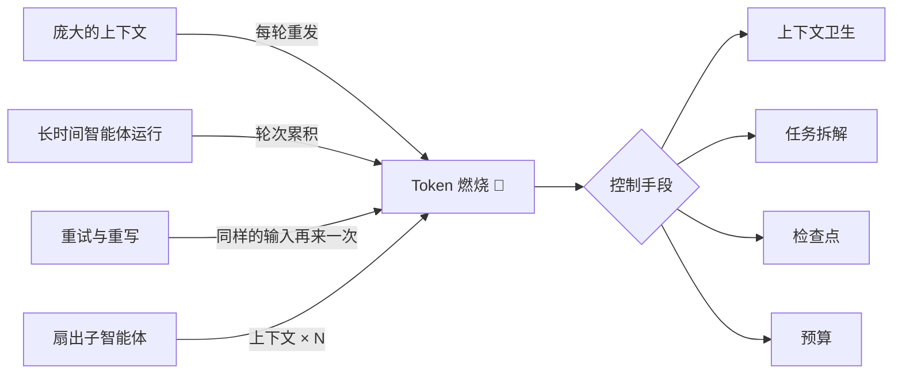
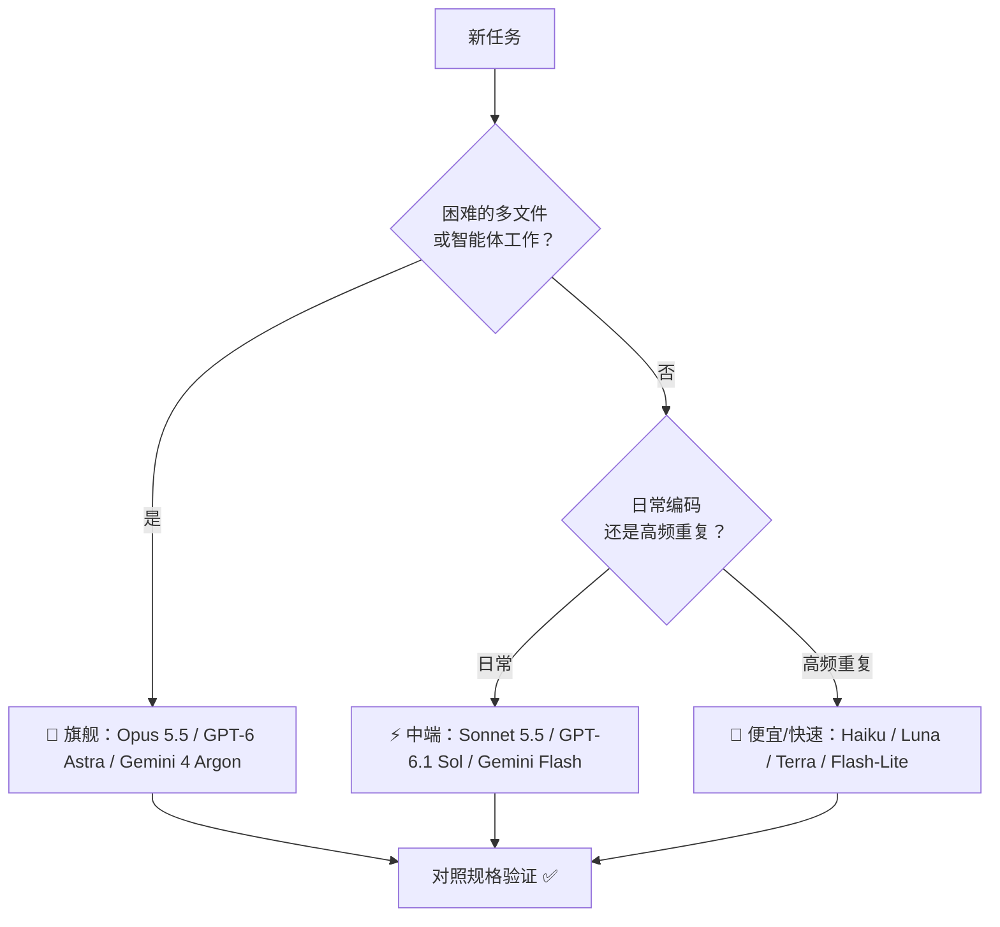

# 💰 31 - AI 成本工程

> **Token 账单就是新的云账单——要像工程师一样管理它，而不是像赌徒。**
> 面向 AI 辅助开发的 Token、模型路由、预算，以及 AI 糟粕的真实成本。

**难度：** 🟡 中级 · **阅读时间：** 约 14 分钟

---

## 📖 目录

- [为什么成本工程现在重要](#-why-cost-engineering-matters-now)
- [Token 与定价如何运作](#-how-tokens--pricing-work)
- [是什么在推高你的账单](#-what-drives-your-bill)
- [模型路由策略](#-model-routing-strategy)
- [具体的成本控制手段](#-concrete-cost-controls)
- [真实世界的月度成本示例](#-real-world-monthly-cost-examples)
- [监控与估算](#-monitoring--estimation)
- [AI 糟粕的经济学](#-the-economics-of-ai-slop)
- [实践清单](#-practical-checklist)
- [自我评估](#-self-assessment)
- [关键要点](#-key-takeaways)
- [下一步](#-next-steps)

---

## 📈 为什么成本工程现在重要

行业已经从**按座位订阅的固定价格**转向了**按消费量/按 Token 计价**。在固定价格下，一次糟糕的会话只是一次糟糕的一天。在按 Token 计价下，它是发票上的一行。

**2026 年 6 月，Gartner 警告**称，基于 Token 的定价会带来不可预测的成本，并预测到 **2028 年，AI 编程成本可能超过开发者的平均薪资**。只有把 Token 当作无限资源的团队，才会让这个预测成真。

令人不舒服的一点是：**失败的尝试如今也会出现在发票上。**

| 旧世界（固定座位） | 新世界（按消费量） |
|------------------------|-------------------------|
| 会话再长也是每月同样的 20 美元 | 会话越长 Token 越多，花的钱越多 |
| 重新提示是"免费"的 | 每次重试都是一次新的输入计费 |
| 一个上下文，一个价格 | 大型项目上下文每轮都要重发 |
| 成本按月可见 | 成本按功能、按智能体运行可见 |
| 浪费看不见 | 浪费可度量——而且可修复 |

---

## 🪙 Token 与定价如何运作

**Token** 是模型计费的单位——大约相当于 ¾ 个英文单词，或约 4 个代码字符。每次 API 调用按四种不同的 Token 类型、以四种不同的费率计费：

| Token 类型 | 是什么 | 相对成本 |
|------------|-----------|---------------|
| **输入** | 你发送的新文本：提示词、新代码、新上下文 | 1×（基准） |
| **输出** | 模型生成的内容：代码、解释 | 通常为输入的 5× |
| **缓存写入** | 稳定的前缀第一次被缓存 | 略高于输入（一次性） |
| **缓存读取** | 后续轮次重读已缓存的上下文 | **约为输入的 10%**——便宜得多 |

### 为什么缓存改变了一切

智能体每轮都会重发整个对话。没有缓存时，10 万 Token 的上下文每轮都要按完整输入价计费。有了缓存，第 2 轮到第 N 轮以极低的价格重读这部分上下文——这就是为什么**对缓存友好的提示词结构**（见下文）是真正的成本控制手段，而不是微优化。

### 实战示例：一次长会话

```
Scenario: 2-hour agent session on Claude Sonnet 5.5
Pricing: $2 input / $10 output per 1M tokens, cache reads ≈ $0.20/1M

Fresh input:    300K × $2/1M     = $0.60
Cache reads:  1,200K × $0.20/1M  = $0.24   ← re-reading context is ~10× cheaper
Output:        120K × $10/1M     = $1.20
────────────────────────────────────────────
Session total ≈ $2.04

× 20 working days ≈ $41/month — from ONE long session on ONE model
```

---

## 🔥 是什么在推高你的账单

| 驱动因素 | 为什么烧 Token | 控制手段 |
|--------|--------------------|---------|
| **上下文窗口大小** | 每轮都要重发整个对话 | 精简摘要、智能体忽略文件、新开会话 |
| **智能体运行长度** | 长时间自主运行会累积轮次 | 限制运行时长；经常设置检查点 |
| **重复重试** | 同一个失败的修复被反复解释 N 次 | 重新提示之前先诊断 |
| **多文件重构** | 每轮都要重读整个文件 | 拆成按文件划分的任务 |
| **子智能体扇出** | 每个子智能体都要重读自己的上下文 | 限制扇出；传递摘要而非原始历史 |
| **图片/大文件附件** | 图片和日志以高费率被 Token 化 | 附加摘录，而非整个文件 |



---

## 🧭 模型路由策略

**按任务路由，而不是凭习惯。** 让旗舰模型处理每一处微不足道的编辑，相当于开着半挂卡车去买菜。

| 层级 | 模型 | 用途 |
|------|--------|---------|
| 🚩 **旗舰** | Claude Opus 5.5、GPT-6 Astra、Gemini 4 Argon | 困难的多文件/智能体工作：架构、棘手的调试、跨领域的重构 |
| ⚡ **中端** | Claude Sonnet 5.5、GPT-6.1 Sol、Gemini Flash | 日常编码：功能、测试、大多数审查与解释 |
| 🌱 **便宜/快速** | Haiku、Luna、Terra、Flash-Lite | 高频重复步骤：重命名、格式化、分类、日志分流 |



**升级规则：** 从你*认为*合适的层级开始，只有当输出证明任务比看起来更难时才升级。任务中途升级只花一次重试的成本；默认用旗舰模型则每个任务都要多花钱。

---

## 🎛️ 具体的成本控制手段

### 1. 上下文卫生

- **精简摘要：** 会话变长时，用一份关于已做决策与已动文件的简短摘要替代原始历史。
- **智能体忽略文件：** 添加类似 `.gitignore` 的忽略列表（`.aiignore`、`AGENTS.md` 排除项），让智能体不加载 `node_modules/`、构建产物、锁文件或日志。
- **清理过期上下文：** 话题变化时开启新会话——把昨天的调试带进今天的功能开发，纯粹是 Token 浪费。

### 2. 任务拆解

大型重试是头号预算杀手。小任务失败的代价也小：

```
❌ "Refactor the entire billing module"        → 40 minutes, fails, 40 minutes wasted
✅ "Extract the invoice calculation into its own function" → 5 minutes, verifiable, done
```

### 3. 检查点

在每个已验证的步骤提交代码。没有检查点时，一个错误一次回退就能解决的问题，会花掉整整一次重新运行的成本——而重新运行要以完整输入价重读整个上下文。

```bash
git add -A && git commit -m "checkpoint: slot availability logic passing"
```

### 4. 支出上限与预算

配置真正能**阻止**过度 Token 消耗的上限，而不只是显示它：

```yaml
# Illustrative budget config — most agents/platforms support something like this
budgets:
  daily_usd: 10
  per_feature_usd: 25
  action_on_exceeded: pause-and-notify   # not "keep going and warn later"
```

### 5. 对缓存友好的提示词结构

把**稳定的内容放前面，易变的内容放最后**，这样缓存的前缀在多轮对话中保持有效：

```
✅ Cache-friendly ordering:
   [system prompt + rules + project context] ← stable, gets cached
   [spec for this feature]                   ← stable while working on it
   [this turn's question]                    ← volatile, goes at the end

❌ Cache-hostile ordering:
   [this turn's question] ... huge context ...
   [rules] ← rules keep moving, cache never hits
```

### 6. 选择带按用量防护的智能体

优先选择自带每次运行 Token 上限、预算警告，以及在昂贵操作前设置权限关卡的智能体（见 [22 - AI 智能体](../22-ai-agents/)）。

---

## 💸 真实世界的月度成本示例

### 订阅套餐（2026 年典型定价）

| 套餐 | 价格 |
|------|-------|
| Claude Pro | $20/月 |
| Claude Max | $100–200/月 |
| Cursor Pro | $20/月 |
| ChatGPT Plus | $20/月 |
| GitHub Copilot | $10–39/月 |

### 按角色划分的大致月度总成本

| 角色 | 典型配置 | 大致月度成本 |
|---------|---------------|--------------------|
| **个人开发者** | Claude Pro 或 ChatGPT Plus + Cursor Pro | **$40–60/月** |
| **专业开发者** | Claude Max (20x) + Cursor Pro + Copilot | **$100–250/月** |
| **重度智能体用户** | Claude Max (100x) + 子智能体/扇出的 API 用量 | **$300–800+/月** |

### API 用量参考（每 100 万 Token）

| 模型 | 输入 | 输出 | 层级 |
|-------|-------|--------|------|
| Claude Opus 5.5 | $4 | $20 | 🚩 旗舰 |
| Claude Sonnet 5.5 | $2 | $10 | ⚡ 中端 |
| GPT-6.1 Terra | $2 | $10 | ⚡ 中端 |
| Kimi K3 | $3 | $15 | ⚡ 中/高 |
| GLM-5.3 | $1.40 | $4.40 | 🌱 经济型 |
| Haiku 5.5 | $0.10 | $0.50 | 🌱 便宜/快速 |
| DeepSeek V4.1 Flash | $0.15 | $0.60 | 🌱 便宜/快速 |

> 旗舰输出 Token（$20/100 万）与便宜层级输入 Token（$0.10/100 万）之间的差距是 **200 倍**。路由决策主导着其他所有成本控制手段。

---

## 📊 监控与估算

无法度量的东西就无法控制。按你做决策的层级来追踪支出：

| 指标 | 如何追踪 | 何时行动 |
|--------|-------------|-------------|
| **每个项目/功能的支出** | 按工作区标记会话或记录 API 用量 | 任何功能的成本超过其大致价值时 |
| **每个已交付功能的成本** | 功能总 Token 数 ÷ 已交付功能数 | 趋势上升而速度持平时 |
| **重试率** | 失败尝试 ÷ 总任务数 | > 30% → 把任务拆得更小 |
| **缓存命中率** | 缓存读取 Token ÷ 总输入 Token | 偏低 → 调整提示词顺序（稳定的放前面） |
| **模型组合** | 旗舰层级的 Token 占比 | > 50% → 审计实际路由情况 |

一份轻量成本日志就足以起步：

```markdown
| Date | Feature | Model | Tokens (in/out) | Cost | Shipped? |
|------|---------|-------|-----------------|------|----------|
| 2026-11-03 | Booking search | Sonnet 5.5 | 820K / 95K | $2.13 | ✅ |
| 2026-11-03 | Payments refactor | Opus 5.5 | 1.4M / 210K | $9.80 | ✅ |
| 2026-11-04 | Log triage (x40) | Haiku 5.5 | 2.1M / 60K | $0.24 | ✅ |
```

**何时切换模型：**
- **降级**：当输出是机械性的，或任务与昨天没有变化时——中端或便宜层级也能通过审查。
- **升级**：当同一任务在低层级上失败两次时——一次旗舰成功比五次中端重试更便宜。
- **换供应商**：当某个便宜的开放权重模型（DeepSeek、GLM、Kimi）能以极低成本处理某项重复工作，且质量可接受时。

---

## 🧮 AI 糟粕的经济学

**便宜不等于省钱，如果返工成倍增加。** 一个 $0.10/100 万 Token 的模型产出的代码如果是复制粘贴、未经重构的，其下游成本会远远超过省下的 Token 费用。

GitClear 对 AI 时代代码的分析发现：

| 指标 | 早期基线 | 2026 年发现 |
|--------|------------------|--------------|
| **复制粘贴的代码行** | 变更代码行的 8.3% | **12.3%**——重复而非推理 |
| **重构** | 约占变更代码行的 25% | **不足 10%**——代码只增不改 |

这就是糟粕税：结构性改进减少了，重复增加了——这意味着*下一个*功能要花更多 Token 去理解、更多时间去修改。

```
True cost of a feature =
    tokens spent generating it
  + tokens spent re-reading bloated context it created
  + rework when duplication breaks invariants
  + maintenance for every future developer (human or agent)
```

**把成本与质量挂钩：** 按*已交付、可维护*的功能来审查成本，而不是按 Token 计费。一个花 8 美元旗舰 Token、一次通过审查的功能，胜过一个花 1 美元、需要三轮返工、还留下重复逻辑的功能。这正是成本工程与 [17 - 真实世界工作流](../17-real-world-workflows/) 质量关卡交汇的地方。

---

## ✅ 实践清单

- [ ] 你知道自己在每个工具和 API 上的**月度 AI 支出**
- [ ] 支出按**项目/功能**追踪，而不只是按工具
- [ ] **旗舰模型留给困难任务**；中端是默认选择
- [ ] **上下文卫生**到位：摘要、智能体忽略文件、新开会话
- [ ] 任务**拆解得足够小**，失败时不会烧掉整个上下文
- [ ] 每个已验证的步骤都有**检查点**（git）
- [ ] **预算已配置**为阻止失控用量，而不只是警告
- [ ] 提示词结构**对缓存友好**（稳定的前缀在前）
- [ ] 你估算**每个已交付功能的成本**并检查质量（无糟粕）

---

## 📊 自我评估

**给自己打分（每项 1-5 分）：**

| 技能 | 评分 | 描述 |
|-------|--------|-------------|
| **定价素养** | _/5 | 你知道所用模型的输入/输出/缓存费率吗？ |
| **模型路由** | _/5 | 你按任务而非凭习惯选择层级吗？ |
| **上下文卫生** | _/5 | 过期上下文和垃圾文件已移出窗口吗？ |
| **预算管理** | _/5 | 存在真正能阻止支出的上限吗？ |
| **每功能成本** | _/5 | 你能说出上一个功能的成本吗？ |

**评分：**
- **5-10 分**：初级——本周开启支出追踪并设置一个预算
- **11-17 分**：中级——加上路由规则，开始估算每个功能的成本
- **18-25 分**：高级——优化缓存命中率，关注质量指标，调优整个模型组合

---

## 📌 关键要点

1. **按消费量计价让每次会话都可计费**——长运行、重试和臃肿的上下文如今都是账单明细，而非背景噪音。
2. **缓存读取便宜得多**——提示词按稳定内容在前来组织，重读上下文就不再主导你的账单。
3. **按任务路由，而非凭习惯**——层级之间的价格差距可达 200 倍；旗舰只用于真正困难的工作。
4. **拆解、设置检查点、做预算**——这三项控制能阻止糟糕的一天变成糟糕的发票。
5. **便宜的 Token + 糟粕 = 昂贵的软件**——GitClear 的复制粘贴/重构变化表明，成本必须与质量挂钩，而不只是与仪表读数挂钩。

---

## 🎯 下一步

现在你可以对 AI 成本做工程化管理了：

1. ✅ **追踪**：开启用量仪表盘，开始为当前项目记录成本日志
2. 💰 **变现**：把成本意识应用到 [18 - 变现](../18-monetization/) 的定价与利润中
3. 💼 **向客户收费**：把 Token 成本计入 [19 - 自由职业](../19-freelancing/) 的费率中
4. 🧠 **选择模型**：在 [04 - AI 模型](../04-ai-models/) 中深入了解层级与权衡

---

> **💡 专业提示：** 像审查云账单一样审查你的 AI 支出——每周一次、按项目审查，只问一个问题："如果路由更好、上下文更小、没有返工，这个功能本该花多少钱？"答案几乎总是*比你现在付的少*。

---

<div align="center">

**管好你的成本——也管好你的 vibe！**  
➡️ [返回：规格驱动开发](../30-spec-driven-development/) ⬅️

[⬆️ 返回导言](../00-introduction/) | [变现](../18-monetization/)

由 Vibe Coding 社区用 ❤️ 制作

</div>
