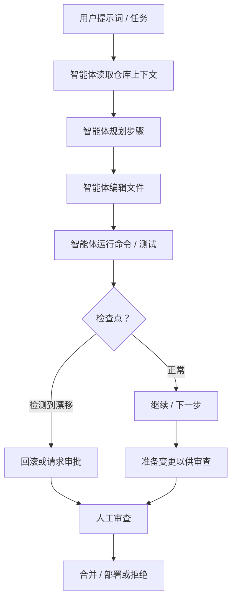

# 🛡️ 32 - AI 智能体安全与治理

> **自主智能体无需你全程盯着，就能读取你的仓库、编辑文件、运行命令、发起拉取请求。安全不是可选项——它是让智能体开发大规模可行的基础设施。**
> **治理把"这是 AI 做的"从一项责任，变成一个可审计、有归属的流程。**

**难度：** 🟡 中级 · **阅读时间：** 约 14 分钟

---

## 📖 目录

- [为什么智能体安全在 2026 年与众不同](#-why-agent-safety-is-different-in-2026)
- [一次智能体运行的构成](#-the-anatomy-of-an-agent-run)
- [长时间运行的智能体安全控制](#-long-running-agent-safety-controls)
- [智能体权限与最小权限](#-agent-permissions--least-privilege)
- [智能体的凭据与密钥卫生](#-credential--secret-hygiene-for-agents)
- [MCP 服务器安全](#-mcp-server-security)
- [审批关卡与人在回路中](#-approval-gates--human-in-the-loop)
- [智能体变更的回滚与事件响应](#-rollback--incident-response-for-agent-changes)
- [实践清单](#-practical-checklist)
- [自我评估](#-self-assessment)
- [关键要点](#-key-takeaways)
- [下一步](#-next-steps)

---

## 🎯 为什么智能体安全在 2026 年与众不同

自动补全只会建议下一行；**智能体会行动**。一个编程智能体可以：

- 检查你的整个仓库并修改几十个文件
- 运行 shell 命令、安装软件包、启动服务
- 执行测试、linter 与构建步骤
- 发起拉取请求并合并代码

这种能力正是智能体的价值所在——也是缺乏治理时它们变得危险的原因。从"AI 建议"到"AI 执行"的转变意味着，一次配置错误的智能体会话引入漏洞、泄露凭据或破坏生产数据的速度，比你审查的速度更快。

**治理原则：** 智能体**有能力，但不担责**。以你的名义，智能体所做的一切仍由你负责。

---

## 🧬 一次智能体运行的构成

这张图里的每个箭头都是一道安全边界。你的工作就是定义并执行 **F**、**J** 与 **K** 处的关卡。

---

## 🛑 长时间运行的智能体安全控制

智能体可以运行几分钟或几小时。在一项两小时任务开始五分钟后出现一个错误假设，就会浪费 Token 并触及许多文件。2026 年的共识控制手段：

| 控制手段 | 作用 | 示例 |
|---------|--------------|---------|
| **检查点** | 在既定间隔揭示工作是否仍在正轨 | "每次编辑文件后，运行测试套件并报告通过/失败" |
| **支出上限** | 在过度 Token 消耗变成账单冲击之前阻止它 | 每个智能体会话最多 50 美元；输入 Token 达到 100 万时硬停止 |
| **隔离环境** | 保护生产系统免受智能体实验的影响 | 无生产网络访问权限的 Docker 容器或临时虚拟机 |
| **可逆变更** | 智能体的每次编辑都必须能回滚 | 所有工作都在 git 分支上；`git revert` 或 `git reset` 作为逃生通道 |
| **敏感操作前审批** | 对不可逆或对外操作进行人工签核 | 部署、数据库迁移、凭据访问、外部 API 调用 |

**经验法则：** 如果智能体的某个操作无法用一条命令撤销，那它在运行之前就需要人工审批。

---

## 🔐 智能体权限与最小权限

只给智能体完成任务所需的最小权限——不多给。

| 权限级别 | 何时授予 | 示例范围 |
|------------------|---------------|---------------|
| **只读** | 代码解释、架构审查 | `git log`、文件列表、读取源文件 |
| **写入（限定分支）** | 功能实现、重构 | 仅在功能分支上编辑文件 |
| **命令执行** | 运行测试、linter、构建 | 在沙箱中运行 `npm test`、`pytest`、`cargo build` |
| **出站网络** | 安装软件包、获取文档 | 仅访问软件包仓库；不访问生产端点 |
| **部署 / 生产** | **默认永不授予** | 每次部署都需要明确的人工审批 |

**绝不要**授予智能体：
- 未经 PR 与人工审查就写入 `main`/`master` 的权限
- 访问生产数据库或凭据
- 对内部服务无限制的出站网络访问
- 修改自身权限配置的能力

---

## 🗝️ 智能体的凭据与密钥卫生

能读取你代码库的智能体，如果密钥已提交或放在环境文件中，也能读到你的密钥。

- **绝不要把密钥粘贴进智能体上下文。** API 密钥、数据库密码与签名密钥不属于提示词。
- **使用密钥管理器**（AWS Secrets Manager、HashiCorp Vault、1Password CLI），让智能体引用密钥的*名称*，而非值。
- **把密钥加入 `.gitignore`**，并启用仓库密钥扫描（GitHub secret scanning、GitGuardian、TruffleHog）。
- **轮换智能体可能见过的任何凭据。** 如果某次智能体会话接触过某个密钥，就把它当作已泄露处理。
- **尽可能使用智能体专用的凭据**——权限有限的、有范围的 API 密钥，而不是你的个人账号。

---

## 🔌 MCP 服务器安全

模型上下文协议（MCP）让智能体可以连接工具与数据源。你添加的每个 MCP 服务器都是一个新的攻击面。

| 风险 | 缓解措施 |
|------|------------|
| 恶意 MCP 服务器外泄代码 | 只运行来自可信发布者的 MCP 服务器；安装前审查服务器代码 |
| MCP 服务器权限过大 | 为每个 MCP 服务器配置所需的最窄工具集 |
| 智能体调用 MCP 工具时传入敏感数据 | 审计 MCP 工具调用日志；避免把 PII 或凭据作为工具参数传递 |
| MCP 服务器在运行时被攻陷 | 在隔离容器中运行 MCP 服务器，不访问生产网络 |

**把每个 MCP 服务器都当作以你的权限运行的不受信任代码。**

---

## 🚦 审批关卡与人在回路中

定义明确的关卡，智能体到此必须停下等你：

| 关卡 | 触发条件 | 审批人 |
|------|---------|--------------|
| **任务前** | 智能体开始一项新的多文件任务 | 开发者 |
| **任务中检查点** | 检查点检测到漂移或测试失败 | 开发者（或自动化规则） |
| **敏感操作** | 部署、迁移、凭据访问、外部调用 | 开发者，如涉及生产还需安全审查 |
| **合并前** | 智能体准备好的 PR 已就绪待审查 | 人工代码审查者（不是智能体） |

**模式：** 智能体提议；人类拍板。智能体准备，人类决策。

---

## ↩️ 智能体变更的回滚与事件响应

当智能体造成问题时，你需要快速恢复：

1. **识别**——找到智能体会话与提交范围（查找 AI 生成的提交信息、智能体编写的 PR）。
2. **遏制**——回滚智能体的分支；撤销它可能访问过的任何凭据。
3. **补救**——修复根本问题（错误的提示词、缺失的护栏、权限过大的智能体）。
4. **复盘**——开展无责事后复盘：哪道护栏失效了，如何防止再次发生？
5. **更新**——收紧智能体权限、增加检查点，或修订审批政策。

**保留智能体审计日志：** 谁启动了会话、用了哪个模型、动了哪些文件、每个关卡由谁审批。这是你的合规线索。

---

## ✅ 实践清单

- [ ] 智能体只在功能分支上工作——绝不直接在 `main` 上工作
- [ ] 每次智能体会话都有明确的支出/Token 上限
- [ ] 智能体工作发生在隔离/沙箱环境中
- [ ] 没有密钥或凭据被粘贴进智能体上下文
- [ ] MCP 服务器来自可信来源且权限最小化
- [ ] 部署、迁移或外部 API 调用前需要人工审批
- [ ] 智能体产出的每次变更在合并前都有人工审查者
- [ ] 保留智能体审计日志（会话、模型、动过的文件、审批）
- [ ] 回滚流程已测试（`git revert` / 删除分支）
- [ ] 智能体访问过的凭据在会话后已轮换

---

## 📊 自我评估

给当前的智能体配置打分（1 = 弱，5 = 强）：

| 领域 | 你的分数 /5 | "5 分"的样子 |
|------|:-------------:|---------------------|
| 智能体分支隔离 | _/5 | 所有智能体工作都在功能分支上，必须走 PR |
| 支出与 Token 上限 | _/5 | 每次会话与每月都有强制硬上限 |
| 密钥卫生 | _/5 | 提示词中没有密钥；正在使用密钥管理器 |
| MCP 安全 | _/5 | 只用可信服务器，最小权限工具集 |
| 审批关卡 | _/5 | 所有敏感操作都有人工签核 |
| 回滚就绪 | _/5 | 任何智能体变更都能用一条命令回滚 |
| 审计线索 | _/5 | 完整的会话日志，含模型、文件、审批 |

**评分：** 30–35 分 = 可用于生产 · 20–29 分 = 收紧护栏 · 低于 20 分 = 暂勿在敏感代码上运行智能体

---

## 🔑 关键要点

- **智能体行动；人类担责。** 治理让自主有安全保障。
- **五项安全控制：** 检查点、支出上限、隔离、可逆性与审批关卡。
- **最小权限同样适用于智能体**——默认只读，只在分支上写入，默认永不接触生产。
- **MCP 服务器是不受信任的代码**——像对待任何依赖一样审计它们。
- **智能体提议；人类拍板。** 没有人工审查就不合并。

---

## 🚀 下一步

- **阅读 [33 — 企业治理与生产可靠性](./33-enterprise-governance/)**，了解组织级护栏、AI 糟粕预防与合规框架。
- **阅读 [31 — AI 成本工程](./31-ai-cost-engineering/)**，把安全与 Token 预算结合起来。
- **阅读 [22 — AI 智能体](./22-ai-agents/)**，了解可在此基础上构建的智能体架构模式。

---

*最后更新：2026 年 11 月*

