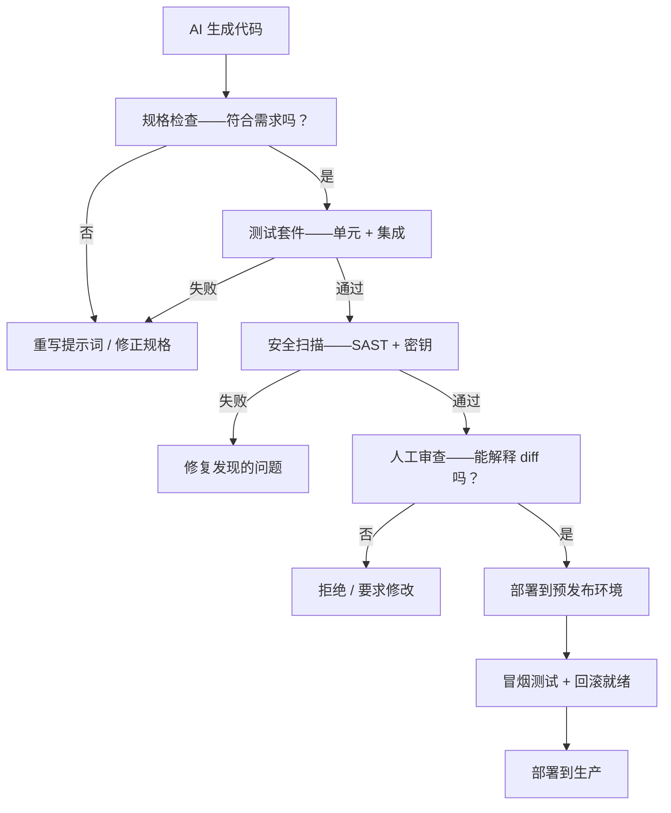

# 🏢 33 - 企业治理与生产可靠性

> **当大部分代码都是机器生成的，"谁负责？"就成了组织里最重要的问题。治理就是回答它的方式——在审计或事故逼你回答之前。**
> **AI 构建应用的生产可靠性需要护栏、归属与验证——而不只是生成速度。**

**难度：** 🟡 中级 · **阅读时间：** 约 14 分钟

---

## 📖 目录

- [从新奇到生产](#-from-novelty-to-production)
- [AI 糟粕：它是什么，如何预防](#-ai-slop-what-it-is-and-how-to-prevent-it)
- [机器生成代码库的治理](#-governance-for-machine-generated-codebases)
- [企业护栏](#-enterprise-guardrails)
- [AI 生成软件的合规框架](#-compliance-frameworks-for-ai-generated-software)
- [AI 构建应用的生产可靠性模式](#-production-reliability-patterns-for-ai-built-apps)
- [归属与维护预算](#-ownership--maintenance-budgeting)
- [实践清单](#-practical-checklist)
- [自我评估](#-self-assessment)
- [关键要点](#-key-takeaways)
- [下一步](#-next-steps)

---

## 📈 从新奇到生产

氛围编程起初是一种快速做原型的方式。2026 年，它已经进入了生产：

- **大部分代码是机器生成的**（据 Oracle 软件工程高级副总裁，2026 年）——而这些代码仍然要由人来维护、治理与理解。
- **约 63% 的氛围编程平台用户不是开发者**——增长来自新进入者，而不是工程师在取代自己。
- **96% 的开发者并不完全信任 AI 生成的代码**（Sonar 2026 年）；只有 48% 在提交前总会检查它。

做出一个应用，不等于做出一个**可靠**的应用。AI 生成的软件看起来可以很出色，里面却可能藏着经验不足的用户难以识别的错误——一个算错总额的预算应用、一个接受冲突预约的预订系统，或一个泄露个人数据的网站。

**治理弥合了"能跑"与"跑起来安全"之间的差距。**

---

## 🧽 AI 糟粕：它是什么，如何预防

**AI 糟粕（AI slop）** 是低价值的机器生成代码：勉强能交付，却难以理解、测试或维护。它是 AI 时代的技术债，以 LLM 的速度生成。

### AI 糟粕的症状

| 症状 | 为什么重要 |
|---------|----------------|
| 代码"看起来正确但不可靠" | 粗看能过关，却在负载或边界情况下失败（Sonar：61% 的开发者见过这种情况） |
| 复制粘贴的代码块而非重构后的代码 | GitClear：复制粘贴的代码行从 8.3% 上升到 12.3%；重构从约 25% 跌到不足变更代码行的 10% |
| 庞大、无差异的 diff | 一个 PR 改了数百个文件，无法有意义地审查 |
| 没有测试或测试很薄 | 生成的代码没有覆盖率就交付；Bug 在生产中浮现 |
| 无人理解 | 最初的提示者无法解释某个模块如何工作 |

### 预防方法

- **先写规格再写代码**——写一份精简规格（第 30 节），让生成有边界、可验证。
- **小而可审查的 PR**——要求智能体把工作拆成小而单一用途的拉取请求。
- **测试先行**——要求 PR 合并前具备测试覆盖率；AI 在实现的同时编写测试。
- **审查每一次变更**——不做"信任智能体"的合并。人类必须能解释每个 diff。
- **积极重构**——把 AI 产出当作初稿，而非最终产品。立即重构重复或绕弯的代码。

---

## 🏛️ 机器生成代码库的治理

当大部分代码都是生成的，治理就从"审查每一行"转向"管理每个意图"。

### 精简定义原则

一份精简的、意图层面的定义（规格、模式、规则文件）比庞杂的生成代码更容易审计。这正是 Oracle 的 APEXlang 等方法背后的逻辑——发布语法、技能与文档，让人类与智能体都能基于一份共享的、可审查的事实来源开展工作。

**在你的组织中应用它：**
- 把 `AGENTS.md` 与 `CLAUDE.md` 存入版本控制，作为权威的智能体指令。
- 把规格（第 30 节）当作一等产物——像审查设计文档一样审查它们。
- 对每个规则文件做版本控制（`.cursor/rules/`、`.github/copilot-instructions.md`、`.kiro/steering/`）。
- 要求任何智能体行为变更都从规格变更开始，而不是从提示词变更开始。

### 归属模型

为每个 AI 生成的组件指定一位**人类负责人**：

| 组件 | 负责人职责 |
|-----------|---------------------|
| AI 生成的服务 | 能解释架构、调试事故、规划迁移 |
| AI 生成的测试套件 | 维护覆盖率，随行为变化更新测试 |
| AI 生成的基础设施 | 管理 IaC，了解回滚流程 |
| AI 生成的安全配置 | 响应发现的问题，轮换凭据 |

**如果没有人能为它负责，就不要交付它。**

---

## 🛡️ 企业护栏

以下是在企业中安全采用 AI 编程的 2026 年共识实践：

| 护栏 | 落地方式 |
|-----------|----------------|
| **每个 PR 自动扫描** | SAST/DAST、密钥扫描、依赖扫描；严重发现阻止合并 |
| **最小智能体权限** | 最小权限；沙箱环境；默认不写入生产 |
| **受保护的凭据** | 密钥扫描、提示词中不放密钥、智能体访问后轮换 |
| **生产变更需人工审批** | 未经明确人工签核，智能体不得触发部署 |
| **威胁建模驱动的测试** | 针对可能的安全威胁编写测试，而不只是功能路径 |
| **代码审查要求** | 每个 AI 生成的 PR 都需要一位能解释 diff 的人工审查者 |
| **智能体审计日志** | 记录会话、模型、动过的文件、审批——为合规保留 |
| **成本与 Token 护栏** | 每个智能体会话的支出上限；达到预算阈值时告警（第 31 节） |

> Gartner（2026 年 11 月）：企业架构与软件工程负责人必须建立护栏、治理与支持模型，以实现 AI 辅助开发的安全采用——没有它们，公民开发者常常陷入提示词编写/排错/返工的循环。

---

## 📋 AI 生成软件的合规框架

AI 生成的代码并不能免除合规义务。恰恰相反，它增加了举证负担。

| 框架 | 与 AI 生成代码的相关性 |
|-----------|-------------------------------|
| **SOC 2 / ISO 27001** | 变更管理、访问控制、审计线索必须覆盖智能体行为 |
| **GDPR / CCPA** | AI 不得处理或泄露个人数据；记录智能体如何处理 PII |
| **HIPAA** | 医疗数据需要严格的访问控制——智能体绝不能看到未加密的 PHI |
| **PCI DSS** | AI 生成代码对支付数据的处理必须经过审查与测试 |
| **AI Act（欧盟）** | 在要求的地方披露软件开发中的 AI 使用；记录高风险系统 |

### 需要记录的内容

- 使用了哪些模型与智能体，用于什么任务
- 代码由谁审查、如何审查
- 密钥与凭据如何与智能体隔离保护
- 涉及 AI 生成代码的事故如何处理
- 智能体会话的审计日志，按保留政策留存

---

## 🚀 AI 构建应用的生产可靠性模式

可靠性是内置的，而不是生成之后再补的。

### 1. 部署前验证

### 2. 测试模式

- **基于属性的测试**——AI 不擅长处理边界情况；基于属性的测试能系统地发现它们。
- **契约测试**——验证 AI 生成的 API 在变更后仍遵守契约。
- **针对 AI 的混沌测试**——故意破坏生成的代码，确认监控能发现问题。

### 3. 监控与可观测性

- 对 AI 生成代码的插桩至少要与人工编写的代码一样完善。
- 对 AI 构建服务中的错误率、延迟与异常流量模式设置告警。
- 追踪"AI 归属"——按代码来源（人工 vs AI）给指标打标签，以便把可靠性与作者关联起来。

### 4. 回滚就绪

- AI 生成代码的每次部署都必须能用一条命令回滚。
- 对 AI 构建的功能使用功能开关，以便无需重新部署即可禁用。
- 对 AI 生成的变更做金丝雀部署——先向 5% 的用户发布，观察指标。

---

## 💰 归属与维护预算

AI 让生成变得便宜，但并没有消除维护成本。

- **为每个 AI 生成的组件预留维护时间**——按生成时间的 2–3 倍估算审查、测试与维护。
- **按已交付功能追踪成本**，而不只是按提示词（第 31 节）。Gartner 警告，到 2028 年 AI 编程成本可能超过开发者的平均薪资。
- **退役或重构**维护成本过高的 AI 生成代码——不要让糟粕积累。
- **在生成时就指定维护负责人**，而不是在事故之后。

---

## ✅ 实践清单

- [ ] 每个 AI 生成的组件都有具名的人类负责人
- [ ] 规格（AGENTS.md、CLAUDE.md、规则文件）已纳入版本控制并经过审查
- [ ] 每个 AI 生成的 PR 都运行自动化安全扫描
- [ ] 未经人工审批，任何智能体都不能部署到生产
- [ ] 密钥从不在智能体上下文中；密钥扫描已启用
- [ ] 智能体审计日志已为合规保留
- [ ] AI 生成的代码在合并前具备测试覆盖率
- [ ] 每次 AI 部署都能用一条命令回滚
- [ ] 生产监控按代码来源（人工 vs AI）归因指标
- [ ] 每个 AI 生成的组件都分配了维护预算
- [ ] 合规映射已记录（SOC 2、GDPR、HIPAA、PCI、AI Act，视适用情况）
- [ ] 事故响应手册涵盖 AI 生成代码的故障

---

## 📊 自我评估

评估你的组织在 AI 治理上的成熟度（1 = 弱，5 = 强）：

| 领域 | 你的分数 /5 | "5 分"的样子 |
|------|:-------------:|---------------------|
| 归属模型 | _/5 | 每个 AI 组件都有具名的人类负责人 |
| 规格治理 | _/5 | AGENTS.md/规则文件像设计文档一样被审查 |
| 护栏 | _/5 | 上表中的所有企业护栏都已强制执行 |
| 合规 | _/5 | AI 使用已映射到 SOC 2 / GDPR / 相关框架 |
| 可靠性 | _/5 | AI 构建的服务具备测试、监控与回滚 |
| 成本追踪 | _/5 | 按功能追踪成本；预算告警已启用 |
| 事故响应 | _/5 | 手册涵盖 AI 生成代码的故障 |
| 维护预算 | _/5 | 已按生成时间的 2–3 倍预留维护预算 |

**评分：** 35–40 分 = 治理成熟 · 25–34 分 = 正式确立护栏 · 低于 25 分 = 不要把 AI 生成的代码部署到生产

---

## 🔑 关键要点

- **大部分代码如今是机器生成的**——治理是让它保持可维护与安全的方式。
- **用规格、小 PR、测试先行与积极重构来预防 AI 糟粕。**
- **企业护栏不可协商：** 扫描每个 PR、智能体最小权限、保护密钥、生产需人工审批。
- **合规仍然适用**——记录模型使用、审查流程与审计线索。
- **可靠性是内置的**——测试、监控、功能开关与一条命令回滚。
- **如果没有人能为它负责，就不要交付它。**

---

## 🚀 下一步

- **阅读 [32 — AI 智能体安全与治理](./32-agent-safety-governance/)**，了解会话级智能体控制（检查点、支出上限、MCP 安全）。
- **阅读 [31 — AI 成本工程](./31-ai-cost-engineering/)**，按已交付功能追踪成本。
- **阅读 [14 — 安全](./14-security/)**，了解漏洞统计与 AI 安全编码实践。

---

*最后更新：2026 年 11 月*

