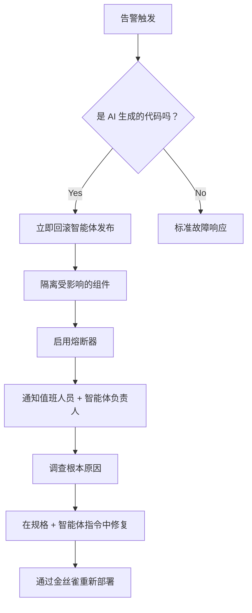

# 🤖 42 - 面向 AI 生成工作负载的 AIOps

> **AI 生成的代码交付很快，但出故障也很快。** AIOps 为 AI 构建的工作负载提供自愈、预测性扩缩容和自动化故障响应，让它们能在生产环境中存活下来。
> **面向 AI 生成代码的运维不是可选项——它是让自主化得以成立的安全网。**

**难度：** 🔴 高级 · **阅读时间：** 约 14 分钟

---

## 📖 目录

- [为什么 AI 构建的工作负载需要 AIOps](#-why-aiops-matters-for-ai-built-workloads)
- [自愈系统](#-self-healing-systems)
- [预测性扩缩容](#-predictive-scaling)
- [自动化故障响应](#-automated-incident-response)
- [金丝雀与发布自动化](#-canary--rollout-automation)
- [AI 生成代码的可观测性](#-observability-for-ai-generated-code)
- [成本运维：Token 与支出自动化](#-cost-ops-token--spend-automation)
- [实践清单](#-practical-checklist)
- [要点总结](#-key-takeaways)
- [下一步](#-next-steps)

---

## 🎯 为什么 AI 构建的工作负载需要 AIOps

AI 生成的代码比人工编写的代码风险更高：它往往缺乏测试、藏有隐蔽的边界情况，还可能在没有被充分理解的情况下部署。传统运维假设代码经过评审和理解；面向 AI 生成工作负载的 AIOps 则假设相反——代码可能很脆弱，并围绕这一现实构建自动化。

**与传统 AIOps 的关键区别：**

| 传统 AIOps | 面向 AI 构建工作负载的 AIOps |
|-------------------|------------------------------|
| 部署前代码经过评审 | 代码可能未经评审；在运行时验证 |
| 可预测的故障模式 | 新出现的、智能体特有的故障模式 |
| 按流量扩缩容 | 按 token 支出 + 流量扩缩容 |
| 回滚很少见 | 回滚是预期内且自动化的 |
| 人工值班响应 | 智能体辅助或自主响应 |

---

## 🩹 自愈系统

自愈意味着系统无需人工干预即可检测故障并恢复。

### 自动重启与熔断器

```yaml
# Example: circuit breaker for an AI-generated API
apiVersion: networking.k8s.io/v1
kind: Service
metadata:
  name: ai-generated-api
spec:
  selector:
    app: ai-generated-api
  ports:
  - port: 8080
```

```python
# Circuit breaker pattern in application code
import pybreaker

breaker = pybreaker.CircuitBreaker(fail_max=3, reset_timeout=30)

@breaker
def call_ai_generated_service(payload):
    # This service may be fragile — protect callers
    return requests.post("http://ai-generated-api:8080/process", json=payload)
```

### 要实现的自愈能力

| 能力 | 作用 | 触发条件 |
|------------|--------------|------------------|
| **自动重启** | 重启失败的容器 | CrashLoopBackOff、OOMKilled |
| **熔断器** | 停止调用故障服务 | 错误率 > 阈值 |
| **自动修复** | 对常见故障运行修复脚本 | 内存过高、死锁、证书过期 |
| **自动扩缩容** | 负载下增加副本 | CPU/内存 > 70% |
| **死信队列** | 捕获失败请求以备评审 | 消息处理失败 |

**原则：** 如果一种故障模式重复出现两次，第三次就把响应自动化。

---

## 📈 预测性扩缩容

AI 生成的工作负载资源模式不可预测。预测性扩缩容在负载到来之前预判它，而不是事后反应。

### 扩缩容依据的指标

| 指标 | 对 AI 工作负载为何重要 |
|--------|--------------------------------|
| **请求速率** | 标准流量信号 |
| **错误率** | AI 生成的代码在负载下可能错误激增 |
| **Token 支出速率** | 智能体会话会烧 token；要设上限 |
| **队列深度** | 智能体生成管道产生的异步工作 |
| **冷启动频率** | AI 服务初始化可能很慢 |

### 带自定义指标的 HPA

```yaml
apiVersion: autoscaling/v2
kind: HorizontalPodAutoscaler
metadata:
  name: ai-generated-workload
spec:
  scaleTargetRef:
    apiVersion: apps/v1
    kind: Deployment
    name: ai-generated-workload
  minReplicas: 2
  maxReplicas: 20
  metrics:
  - type: Object
    object:
      metric:
        name: token-spend-per-minute
      target:
        type: Value
        value: "1000"
  behavior:
    scaleUp:
      stabilizationWindowSeconds: 30
      policies:
      - type: Pods
        value: 4
        periodSeconds: 15
    scaleDown:
      stabilizationWindowSeconds: 300
```

### 预测性（而不只是反应性）扩缩容

- **基于排期的扩缩容**——在已知的流量高峰前扩容（例如工作时间）
- **基于 ML 的预测**——用历史用量预测明天的负载
- **Token 预算感知的扩缩容**——token 支出达到每日预算时停止扩容

---

## 🚨 自动化故障响应

当 AI 生成的代码在生产环境中出故障时，响应必须快速且有结构。

### AI 工作负载的故障响应手册



### 自动化响应动作

| 动作 | 自动化工具 | 示例 |
|--------|----------------|---------|
| 回滚 | `kubectl rollout undo` | 撤销上一次智能体发布 |
| 熔断器 | 服务网格（Istio/Linkerd） | 停止流向故障 Pod 的流量 |
| 告警 | PagerDuty、Opsgenie、Slack | 通知值班人员 + 智能体负责人 |
| 日志捕获 | ELK、Loki | 拉取智能体会话的日志 |
| 工单创建 | Jira、Linear | 自动创建故障工单 |

### 运行手册要点

每个 AI 构建的服务都需要一份运行手册，其中包括：

- **服务是做什么的**（以及负责人是谁）
- **如何回滚**（一条命令）
- **常见故障模式**（来自智能体行为模式）
- **通知谁**（智能体负责人，而不只是基础设施值班人员）
- **事后行动**（更新规格、收紧智能体护栏）

---

## 🔄 金丝雀与发布自动化

AI 生成的变更绝不应该立即推送给 100% 的流量。

### 金丝雀部署流水线

```yaml
# Argo Rollouts example for AI-generated service
apiVersion: argoproj.io/v1alpha1
kind: Rollout
metadata:
  name: ai-generated-service
spec:
  replicas: 5
  strategy:
    canary:
      steps:
      - setWeight: 10       # 10% traffic to new version
      - pause: {duration: 5m} # Watch metrics
      - setWeight: 50       # 50% traffic
      - pause: {duration: 10m}
      - setWeight: 100      # Full rollout
  template:
    spec:
      containers:
      - name: app
        image: ghcr.io/yourusername/ai-app:latest
```

### 自动化回滚触发器

| 指标 | 阈值 | 动作 |
|--------|-----------|--------|
| 错误率（5xx） | 3 分钟内 > 1% | 回滚 |
| 延迟 p95 | 5 分钟内 > 2 秒 | 回滚 |
| Pod 重启率 | 10 分钟内 > 5 次 | 回滚 + 告警 |
| Token 支出 | > 每日预算 | 停止智能体会话 |

---

## 📊 AI 生成代码的可观测性

对 AI 构建服务的检测，至少要与人工编写的代码一样彻底。

### 关键信号

| 信号 | 为什么跟踪它 |
|--------|--------------|
| **代码来源** | 按人工与 AI 作者身份标记指标 |
| **智能体会话 ID** | 把问题与具体的智能体运行关联起来 |
| **所用模型** | 不同模型有不同的故障模式 |
| **每次请求的 token 成本** | 发现失控的智能体行为 |
| **评审状态** | 这段代码在部署前是否经过人工评审？ |

### 示例：标记 AI 生成的代码

```python
# Middleware to tag requests served by AI-generated code
@app.middleware("http")
async def tag_ai_origin(request, call_next):
    request.state.code_origin = "ai_generated"
    request.state.agent_session = os.getenv("AGENT_SESSION_ID", "unknown")
    response = await call_next(request)
    response.headers["X-Code-Origin"] = "ai_generated"
    return response
```

### 要构建的仪表盘

- **AI 代码与人工代码的错误率**——比较可靠性
- **Token 支出随时间的变化**——发现预算超支
- **回滚频率**——衡量 AI 发布的质量
- **智能体会话时长**——发现失控的会话

---

## 💰 成本运维：Token 与支出自动化

AIOps 也包括成本控制。按 token 计价意味着每次智能体会话都有对应的美元价值。

### 支出控制

| 控制措施 | 实现方式 |
|---------|---------------|
| **每次会话 token 上限** | 达到 N 个 token 时停止智能体 |
| **每日预算告警** | 预算 > 80% 时通知值班人员 |
| **每次请求成本跟踪** | 为每个请求标记 token 成本 |
| **模型路由强制执行** | 把便宜的任务路由到便宜的模型 |
| **空闲会话终止** | N 分钟无活动后终止智能体 |

### 示例：支出告警

```yaml
# Prometheus alert for token spend
groups:
- name: token-spend
  rules:
  - alert: HighTokenSpend
    expr: token_spend_per_hour > 500
    for: 5m
    annotations:
      summary: "AI token spend exceeding budget"
```

---

## ✅ 实践清单

- [ ] 所有 AI 构建的服务都配置了自动重启
- [ ] 熔断器保护了脆弱 AI 服务的调用方
- [ ] HPA 配置了自定义指标（包括 token 支出）
- [ ] 金丝雀部署流水线带自动化回滚
- [ ] 每个 AI 构建的服务都有运行手册
- [ ] 代码来源已在指标中标记（人工 vs AI）
- [ ] 每次会话的 token 上限已强制执行
- [ ] 每日支出告警已配置
- [ ] 回滚已在预发布环境测试
- [ ] 故障响应运行手册包含智能体负责人

---

## 🔑 要点总结

- **AI 生成的代码默认是脆弱的**——AIOps 是安全网
- **自愈** = 自动重启、熔断器、自动修复
- **预测性扩缩容**要考虑 token 支出，而不只是流量
- **金丝雀 + 自动化回滚**——绝不要把 AI 变更立即部署给 100% 的流量
- **标记代码来源**——比较 AI 与人工的可靠性
- **成本是一项运维指标**——像跟踪 CPU/内存一样跟踪 token 支出

---

## 🚀 下一步

- **阅读第 43 节**（智能体间协作模式），了解如何编排多个智能体
- **阅读第 44 节**（高级合规自动化），了解规模化治理
- **阅读第 36 节**（Kubernetes 部署），了解 AIOps 赖以构建的部署基础

---

<center>

*最后更新：2026 年 11 月*

</center>
