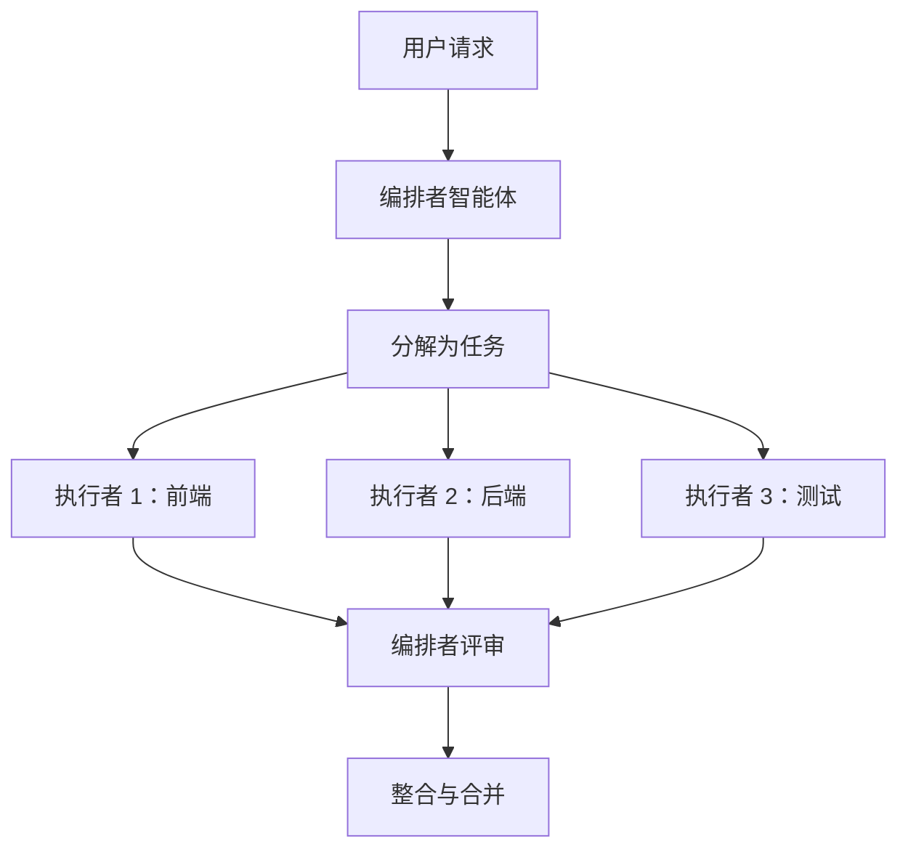
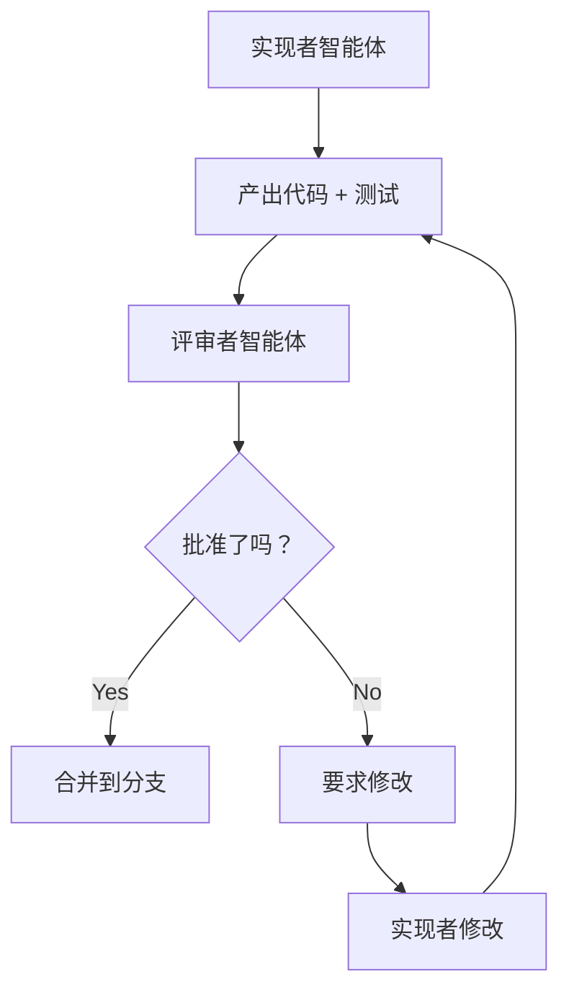
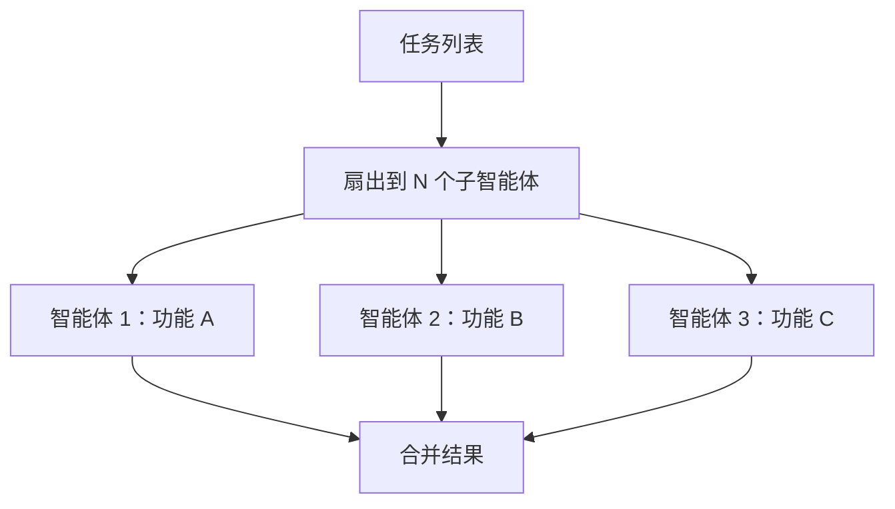

# 🤝 43 - 智能体间协作模式

> **一个智能体可以构建一个功能。多个智能体可以构建一个系统——前提是它们协作时互不干扰。** 本节介绍编排智能体团队的模式：编排者–执行者、评审者–实现者、并行子智能体，以及冲突解决。
> **协作是乘数。协调是护栏。**

**难度：** 🔴 高级 · **阅读时间：** 约 14 分钟

---

## 📖 目录

- [为什么需要多智能体协作](#-why-multi-agent-collaboration)
- [编排者–执行者模式](#-orchestrator-worker-pattern)
- [评审者–实现者模式](#-reviewer-implementer-pattern)
- [并行子智能体模式](#-parallel-subagents-pattern)
- [辩论与共识模式](#-debate--consensus-pattern)
- [交接与上下文传递](#-handoff--context-transfer)
- [冲突解决](#-conflict-resolution)
- [共享记忆与状态](#-shared-memory--state)
- [实践清单](#-practical-checklist)
- [要点总结](#-key-takeaways)
- [下一步](#-next-steps)

---

## 🎯 为什么需要多智能体协作

单个智能体有其局限：上下文窗口、推理深度、注意力持续时间。把工作分给专业化的智能体可以处理更大的任务，但也会引入新风险：相互冲突的编辑、上下文漂移、重复工作和循环依赖。

**目标：** 获得更多能力，而不是更多混乱。每种多智能体模式都需要一种协调机制。

---

## 🎻 编排者–执行者模式

一个智能体（编排者）规划工作、分解任务，并委派给专业智能体（执行者）。编排者评审结果并整合它们。

### 何时使用

- 复杂的多步骤任务（迁移、重构、新功能）
- 需要不同专长的工作（前端、后端、基础设施）
- 分解有助于提高质量的任务

### 如何运作



### 实现要点

- **编排者拥有计划**——执行者只执行，不偏离
- **执行者汇报状态**——已完成、被阻塞，或需要澄清
- **编排者负责整合**——解决合并冲突、运行完整测试套件
- **超时保护**——如果某个执行者停滞，编排者重新分配或升级处理

### 任务分解示例

```
Task: Add user settings page
├─ Worker A (Frontend): Settings form component + validation
├─ Worker B (Backend): Settings API endpoint + database schema
├─ Worker C (Tests): Unit + integration tests
└─ Orchestrator: Review all, integrate, deploy
```

---

## 🔄 评审者–实现者模式

一个智能体实现；另一个评审。评审者可以拒绝、要求修改或批准。这与人工 PR 评审类似，只是以智能体的速度进行。

### 何时使用

- 安全敏感代码
- Bug 代价高昂的复杂逻辑
- 合并前想获得“第二意见”时

### 如何运作



### 评审者清单（智能体可读）

- [ ] 测试覆盖了新功能
- [ ] 代码中没有密钥或凭证
- [ ] 有错误处理
- [ ] 已考虑性能影响
- [ ] 符合项目风格（AGENTS.md）

---

## ⚡ 并行子智能体模式

多个独立的智能体同时处理各自独立、互不重叠的任务。最适合可以扇出的工作，即任务之间不共享状态。

### 何时使用

- 独立的功能或 Bug 修复
- 跨多个文件的代码生成
- 为现有代码库生成测试
- 编写文档

### 何时不使用

- 编辑相同文件的任务（冲突）
- 需要共享上下文的任务（漂移风险）
- 有先后依赖的任务（一个任务阻塞另一个）

### 实现方式



### 安全规则

- **每个智能体在自己的分支上**——不共享工作目录
- **不共享状态**——智能体不读取其他智能体未提交的变更
- **合并关卡**——人工或编排者在合并前评审所有 PR
- **冲突检测**——CI 检测重叠的文件编辑

---

## 🗣️ 辩论与共识模式

多个智能体讨论一项设计决策，提出论点，并收敛到一个推荐方案。最终由人类（或元智能体）拍板。

### 何时使用

- 架构决策（数据库选择、框架、API 风格）
- 安全权衡
- 有竞争方案的性能优化

### 如何运作

```
Round 1: Each agent proposes an approach + rationale
Round 2: Agents critique each other's proposals
Round 3: Agents revise or concede
Round 4: Consensus recommendation + human decision
```

### 辩论主题示例

“我们应该为设置服务使用 PostgreSQL 还是 MongoDB？”

- 智能体 A（PostgreSQL）：“结构化数据、ACID，更适合关系型设置”
- 智能体 B（MongoDB）：“灵活的表结构、原型开发更快、扩缩容更容易”
- 第 2 轮批评：A 指出 MongoDB 缺乏事务；B 指出 PostgreSQL 不够灵活
- 人类根据团队专长和运维约束做出决定

---

## 🤝 交接与上下文传递

当一个智能体完成工作、另一个智能体接手时，上下文必须干净地传递。没有交接，第二个智能体会重复工作或引入不一致。

### 交接产物

```
# Handoff from Agent A to Agent B

## Task completed
- Implemented user authentication (JWT, httpOnly cookies)

## Files changed
- src/auth/middleware.ts
- src/auth/routes.ts
- src/auth/passport.ts

## Tests
- src/auth/middleware.test.ts (passing)
- src/auth/routes.test.ts (passing)

## Known issues
- Token refresh edge case not handled (see TODO in middleware.ts)

## Next steps
- Implement password reset flow
- Add rate limiting to auth endpoints

## Context for continuation
- Database schema: users table in migrations/001.sql
- Environment: AUTH_SECRET must be set
- AGENTS.md: see authentication section
```

### 交接规则

- **绝不口头交接**——写进交接文档或 PR 评论中
- **包含已知问题**——不要对下一个智能体隐瞒问题
- **包含上下文**——文件路径、环境变量、测试状态
- **包含下一步**——下一个智能体首先应该做什么

---

## ⚔️ 冲突解决

多智能体工作会产生冲突：重叠的编辑、相互矛盾的决策、重复的工作。

### 冲突类型

| 类型 | 示例 | 解决方法 |
|------|---------|------------|
| **编辑冲突** | 两个智能体编辑同一个文件 | Git 合并；由人工或编排者解决 |
| **决策冲突** | 智能体 A 选择 PostgreSQL，智能体 B 选择 MongoDB | 辩论模式；由人工决定 |
| **重复工作** | 两个智能体构建了同一个功能 | 编排者发现；保留一个，删除另一个 |
| **上下文漂移** | 智能体 B 基于过时的假设工作 | 交接文档；重新同步上下文 |

### 预防措施

- **每个智能体一个分支**——合并前隔离工作
- **文件归属**——把文件分配给智能体；不重叠归属
- **每日同步**——智能体（或编排者）每天同步进度
- **CI 冲突检测**——文件重叠时阻止合并

---

## 🧠 共享记忆与状态

智能体需要一个共享的事实来源来避免漂移。

### 共享记忆选项

| 选项 | 最适合 | 权衡 |
|--------|----------|-----------|
| **AGENTS.md / CLAUDE.md** | 项目级指令 | 静态；无法捕获运行时状态 |
| **共享知识库** | 项目长期记忆 | 需要维护 |
| **黑板模式** | 主动协作 | 实现复杂 |
| **数据库/状态存储** | 运行时状态 | 基础设施开销 |

### 黑板模式示例

```
Blackboard (shared state):
├─ Current sprint goals
├─ In-progress tasks & owners
├─ Completed work & links
├─ Blocked items & reasons
└─ Decisions made & rationale
```

智能体在每项任务前后读写黑板。

---

## ✅ 实践清单

- [ ] 已为多智能体任务定义编排者智能体
- [ ] 每个智能体都在自己的分支上工作
- [ ] 安全敏感代码使用了评审者–实现者模式
- [ ] 并行子智能体仅用于独立、互不重叠的任务
- [ ] 智能体交接之间编写了交接文档
- [ ] CI 中有冲突检测（重叠的文件编辑会被阻止）
- [ ] 共享记忆（AGENTS.md、黑板）得到维护
- [ ] 架构决策使用了辩论模式
- [ ] 最终合并决策有人类参与
- [ ] 智能体审计日志记录了谁在何时做了什么

---

## 🔑 要点总结

- **一个智能体构建；多个智能体协作**——但协调才是难点
- **编排者–执行者**用于复杂分解；**评审者–实现者**用于质量；**并行子智能体**用于扇出
- **绝不要让智能体同时编辑相同的文件**——每个智能体一个分支
- **交接文档防止上下文漂移**——把它们写下来
- **CI 中的冲突检测**能在重叠变成合并灾难之前发现它们
- **人类做最终决定**——智能体提议，人类拍板

---

## 🚀 下一步

- **阅读第 44 节**（高级合规自动化），了解规模化治理
- **阅读第 42 节**（面向 AI 生成工作负载的 AIOps），了解多智能体系统的运维
- **阅读第 41 节**（生态系统集成），了解为智能体协作提供动力的 MCP 服务器

---

<center>

*最后更新：2026 年 11 月*

</center>
