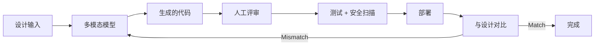

[English 原文](../../45-multi-modal-vibe-coding/README.md)

# 🎨 45 - 多模态氛围编程

> **代码并不总是从文字开始。** 多模态氛围编程（Vibe Coding）让你用图片、模型稿、截图和 Figma 文件进行设计，然后让 AI 直接把它们转换成可运行的代码。
> **从像素到生产：少描述，多展示。**

**难度：** 🟡 中级 · **阅读时间：** 约 12 分钟

---

## 📖 目录

- [什么是多模态氛围编程](#-what-is-multi-modal-vibe-coding)
- [多模态工作流](#-the-multi-modal-workflow)
- [图片 → 代码：从模型稿生成 UI](#-image-to-code-ui-from-mockups)
- [设计文件 → 代码：Figma 转组件](#-design-file-to-code-figma-to-components)
- [截图 → 代码：克隆与逆向工程](#-screenshot-to-code-cloning--reverse-engineering)
- [草图 → 代码：手绘转数字化](#-sketch-to-code-hand-drawn-to-digital)
- [视频与录屏 → 代码](#-video--screen-recording-to-code)
- [多模态安全与评审](#-multi-modal-safety--review)
- [实践清单](#-practical-checklist)
- [要点总结](#-key-takeaways)
- [下一步](#-next-steps)

---

## 🎯 什么是多模态氛围编程

多模态氛围编程使用同时理解图片和文字的 AI 模型。你不必用文字描述 UI，而是向模型展示截图、Figma 文件或手绘草图，它会生成相应的代码。

**演进过程：**
- **文字 → 代码：**“创建一个带邮箱和密码字段的登录页”
- **图片 → 代码：** 上传模型稿 → 生成 React 组件
- **设计 → 代码：** Figma 文件 → 可用于生产的 Tailwind + TypeScript
- **视频 → 代码：** 录屏 → 可交互原型

---

## 🔄 多模态工作流

**关键阶段：**
1. **设计输入**——图片、模型稿、草图或设计文件
2. **模型生成**——多模态模型产出代码
3. **人工评审**——验证代码是否符合设计意图
4. **测试 + 安全**——标准质量关卡（绝不跳过）
5. **部署**——验证通过后发布
6. **视觉对比**——检查渲染输出是否与原始设计一致

---

## 🖼️ 图片 → 代码：从模型稿生成 UI

### 效果好的场景

- 静态 UI 布局（落地页、仪表盘、表单）
- 组件库（按钮、卡片、弹窗）
- 设计系统实现
- 响应式断点

### 要注意的问题

- **文字准确性**——模型可能拼错或幻觉出文案
- **交互性**——图片不展示行为；你必须自己添加逻辑
- **无障碍**——模型经常遗漏 ARIA 标签、键盘导航
- **响应式**——单张图片无法涵盖移动端/平板/桌面端

### 示例工作流

1. 上传一张落地页模型稿（PNG/JPG）
2. 提示词：“把它转换成 React + Tailwind 组件。包含无障碍标签和响应式断点。”
3. 对照图片评审生成的代码
4. 添加交互（表单处理、导航）
5. 在多种屏幕尺寸上测试

---

## 📐 设计文件 → 代码：Figma 转组件

Figma 文件是最丰富的设计输入——包含图层、自动布局、排版、颜色和间距 token。

### Figma 转代码工作流

1. **从 Figma 导出画板**为图片，或使用 Figma MCP 插件
2. **用图片 + 设计上下文提示模型**：
   - “这是一个用户个人页的 Figma 设计。用设计系统 token 生成 Next.js + Tailwind 组件。”
   - “精确匹配设计中的间距、排版和颜色。”
3. **创建设计系统**——把颜色、间距、排版提取到 Tailwind 配置或 CSS 变量中
4. **构建组件**——每个 Figma 画板/组件对应一个组件
5. **验证**——用视觉差异工具比较渲染输出与 Figma

### Figma 专属注意事项

- **自动布局** → CSS Flexbox/Grid
- **组件** → React/Vue 组件
- **变体** → 组件 props（尺寸、颜色、状态）
- **约束** → 响应式行为

### 可考虑的工具

- **Figma MCP 服务器**——通过模型上下文协议直接读取 Figma 文件
- **Vercel 的 v0**——图片转 UI 生成
- **Cursor + 图片上传**——直接把 Figma 截图粘贴到对话中

---

## 📸 截图 → 代码：克隆与逆向工程

截图让你可以快速复现现有 UI。

### 合法用途

- 用现代技术栈重建你自己的旧版 UI
- 学习公开的设计模式
- 创建与现有产品风格一致的内部管理工具
- 用利益相关方提供的截图做原型

### ⚠️ 法律与伦理边界

- **不要克隆你没有所有权或使用权的受版权保护设计**
- **不要抓取竞争对手的 UI** 来复制他们的产品
- **尊重商标**——Logo、品牌颜色、独特的商业外观
- **有疑问时先问**——复现他人的 UI 之前先获得许可

### 工作流

1. 截取目标 UI 的截图
2. 提示词：“用 HTML + CSS 复现这个布局。聚焦结构和样式，而非功能。”
3. 用你自己的内容替换占位内容
4. 添加你自己的功能和品牌

---

## ✏️ 草图 → 代码：手绘转数字化

手绘草图是捕捉想法最快的方式。多模态模型可以理解它们。

### 最佳实践

- **画清楚**——用深色笔在白纸上画，光线充足
- **标注元素**——在草图上写“登录按钮”“用户头像”等
- **标明布局**——展示哪些元素并排、哪些上下堆叠
- **注明交互**——写“点击打开弹窗”“提交发送表单”

### 工作流

1. 在纸上或白板上画出 UI 草图
2. 在光线充足的情况下拍照
3. 上传 + 提示词：“把这张手绘草图转换成 React 组件。按我写的标注命名元素。”
4. 优化生成的代码——草图不够精确，你需要清理

---

## 🎥 视频与录屏 → 代码

视频捕捉的是行为，而不只是外观——交互、动画、过渡。

### 视频带来的额外信息

- **动效**——悬停状态、过渡、动画
- **流程**——多步骤用户旅程
- **行为**——点击、滚动、提交时会发生什么

### 局限性

- **对模型来说难得多**——视频理解远不如图片理解成熟
- **处理时间更长**——视频消耗更多 token 和时间
- **时间上的歧义**——模型可能误解时机和顺序

### 工作流

1. 录制一段简短的录屏（10–30 秒），展示期望的行为
2. 上传 + 提示词：“这段视频展示了一个结账流程。生成 React 组件和交互逻辑。”
3. 一步一步实现——不要试图一次从一个视频生成所有内容
4. 对照视频测试每个交互

---

## 🛡️ 多模态安全与评审

多模态输入带来了新的风险：

| 风险 | 缓解措施 |
|------|-----------|
| **侵犯版权** | 只使用你拥有或有权使用的设计 |
| **图片中的隐私数据** | 截图可能包含 PII、凭证、内部信息 |
| **缺失无障碍** | 模型会跳过 ARIA、键盘导航、颜色对比度 |
| **视觉幻觉** | 模型会凭空编造图片中没有的细节 |
| **安全缺口** | 生成的代码可能缺少认证、校验、净化 |

### 多模态输出评审清单

- [ ] 对照原始设计比较渲染代码——视觉上是否匹配？
- [ ] 上传前截图中没有 PII 或凭证
- [ ] 无障碍审计——ARIA 标签、键盘导航、颜色对比度
- [ ] 安全评审——认证、输入校验、无密钥
- [ ] 响应式检查——移动端、平板、桌面端
- [ ] 性能——生成的代码没有被未使用的样式拖垮

### 视觉验证工具

- **视觉差异**——Percy、Chromatic、Storybook（比较渲染输出与设计）
- **无障碍**——axe-core、Lighthouse、WAVE
- **响应式测试**——浏览器开发者工具、BrowserStack

---

## ✅ 实践清单

- [ ] 只使用你拥有或有权使用的设计
- [ ] 上传前从截图中清除 PII/凭证
- [ ] 提示词中要求无障碍（ARIA、键盘导航、对比度）
- [ ] 对照原始设计直观评审生成的代码
- [ ] 添加图片无法展示的交互
- [ ] 测试响应式断点
- [ ] 对生成的代码运行安全扫描
- [ ] 为组件行为添加测试
- [ ] 在 AGENTS.md 中记录设计到代码的决策

---

## 🔑 要点总结

- **展示，而不只是讲述**——图片和设计文件比文字更能传达 UI 意图
- **多模态模型连接设计与代码**——Figma、截图、草图都适用
- **图片不展示行为**——你必须添加交互、逻辑和无障碍
- **法律边界很重要**——不要克隆受版权保护的设计；清除截图中的 PII
- **直观评审**——生成的代码必须与设计匹配，而不只是“看起来接近”
- **标准质量关卡仍然适用**——测试、安全扫描、无障碍审计

---

## 🚀 下一步

- **阅读第 44 节**（高级合规自动化），了解设计到代码工作流中的合规
- **阅读第 41 节**（生态系统集成），了解 Figma MCP 服务器和设计系统工具
- **阅读第 35 节**（入门套件），了解设计系统就绪的入门模板

---

*最后更新：2026 年 11 月*

